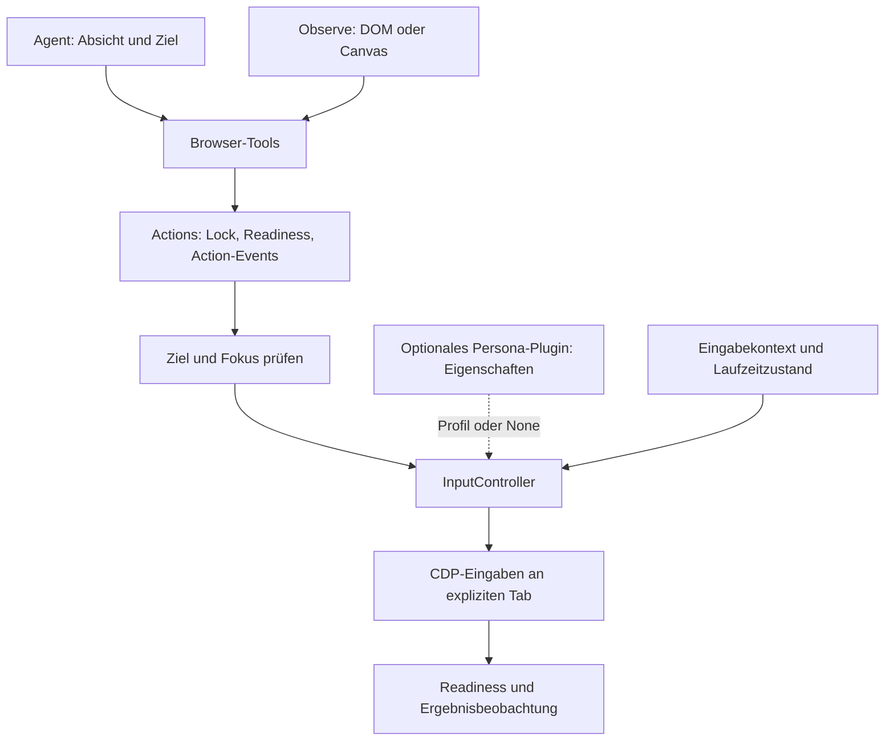

# Konzept: Persona, Tastatur und Texteingabe in Browserrig

Status: Architekturvorschlag auf Basis des aktuellen Repositories. Dieses Dokument
beschreibt eine mögliche Umsetzung; die genannten neuen APIs sind noch nicht implementiert.

## 1. Grundidee

Browserrig bekommt eine gemeinsame Eingabeschicht für Tastatur, Text, Maus und
Scrollen. Ein optional registriertes `Persona`-Plugin hält Eigenschaften wie
Tippgeschwindigkeit und konfiguriert damit deren Verhalten. Ohne dieses Plugin
verwendet Browserrig seinen normalen Eingabepfad. DOM- und Canvas-Modus verwenden
dieselbe Eingabeschicht und unterscheiden sich weiterhin darin, wie sie die Seite
beobachten und Ziele adressieren.

Das mentale Modell dafür lautet:

> Der Agent entscheidet, was er tun möchte. Die Observation beschreibt die aktuelle
> Seite. Actions sichert die Ausführung ab. Die Eingabeschicht übersetzt die Absicht
> in konkrete Browser-Eingaben. Ist eine Persona registriert, bestimmen ihre
> Eigenschaften den Ausführungsstil.

„Persona“ meint hier ein konsistentes Interaktionsprofil, etwa zügiges oder bewusst
langsames Tippen. Sprachliche Rolle, Fachwissen und Aufgabenstrategie bleiben in den
Agent-Instructions. Browser-Konfiguration wie Viewport und Verbindungsdaten bleibt
in den Browser-Options.

## 2. Ausgangspunkt im aktuellen Code

| Stelle                            | Aktuelles Verhalten                                                                        | Ansatzpunkt                                                                   |
| --------------------------------- | ------------------------------------------------------------------------------------------ | ----------------------------------------------------------------------------- |
| `browserrig/tools/execution.py`   | `Actions.run()` serialisiert Aktionen, prüft Readiness und erzeugt Action-Events.          | Bleibt die gemeinsame Transaktionsgrenze.                                     |
| `browserrig/tools/forms.py`       | `type_text(ref, text, clear=True)` fokussiert ein DOM-Element und verwendet `insert_text`. | Zielauflösung und Texteingabe voneinander trennen.                            |
| `browserrig/browser/tab.py`       | `Tab.press_key()` parst derzeit Strings wie `Control+a` und sendet CDP-Eingaben.           | Durch typisierte Tasten und explizite Flags wie `hold_control=True` ersetzen. |
| `browserrig/tools/interaction.py` | `PointerTools` bietet in beiden Modi Tasten, Klicks, Scrollen und Drags an.                | Tastatur von Pointer-Tools unabhängig machen.                                 |
| `browserrig/tools/gestures.py`    | Klicks und Drags enthalten konkrete CDP-Sequenzen und Cleanup.                             | Als Grundlage für Pointer-Ausführung weiterverwenden.                         |
| `browserrig/composition.py`       | DOM erhält zusätzlich `FormTools`; Canvas hat dadurch kein Text-Tool.                      | Gemeinsame Keyboard-Tools in beiden Modi bereitstellen.                       |
| `browserrig/kinds.py`             | Geschlossene Werte sind bereits als `StrEnum` modelliert.                                  | Für Eingabemodi, Modifier und weitere feste Zustände fortführen.              |
| `browserrig/activity/`            | Activity misst Modell-, Tool-, Readiness- und Pausenintervalle.                            | Eingabezeiten innerhalb der vorhandenen Tool-Zeit erfassen.                   |

Die bestehenden Grenzen sind dafür bereits brauchbar. Es braucht vor allem eine
Bündelung der Eingabelogik unterhalb der Tools.

## 3. Vier Dinge getrennt halten

| Begriff           | Verantwortung                                                                                           | Lebensdauer                                                       |
| ----------------- | ------------------------------------------------------------------------------------------------------- | ----------------------------------------------------------------- |
| Observation-Modus | Welche Informationen sieht der Agent, und wie adressiert er Ziele?                                      | Konfiguration des Browser-Agenten                                 |
| Persona-Plugin    | Hält Eigenschaften dafür, wie Eingaben zeitlich und motorisch ausgeführt werden.                        | Optional registriert; unveränderliche Konfiguration pro Session   |
| Eingabekontext    | Welche Plattform, Tastenabbildung und Eingabefähigkeiten gelten im Browser?                             | Explizite Konfiguration beziehungsweise ausgehandelte Fähigkeiten |
| Eingabezustand    | Welche Tasten und Buttons hält Browserrig, wo steht der Pointer, welcher Fokus wurde zuletzt bestätigt? | Laufzeit, mit Bezug auf Tab, Frame und Dokument                   |

Damit lassen sich `DomMode` und `CanvasMode` jeweils mit derselben Persona verwenden.
Ein Wechsel des Observation-Modus erzeugt weder eine neue Persönlichkeit noch einen
anderen Tastatur-Backend.

Wichtig: Eine Persona enthält keine aktuellen Element-Refs, keinen Cursorzustand und
keine gedrückten Tasten. Solche Werte wären nach Navigation, Tabwechsel oder einem
externen Eingriff schnell falsch.

## 4. Vorgeschlagene Architektur



`InputController` ist hier ein Arbeitsname. Er übernimmt die Ausführung von
Text-, Tastatur-, Pointer- und Scrollbefehlen. Er plant keine Browser-Aufgaben und
fordert keine eigenen Modellantworten an.

Ein dünnes Harnessed-Plugin stellt ihn per Dependency Injection bereit. Die
eigentliche Eingabelogik bleibt unabhängig von Agent-Prompts und Session-Logs, damit
auch direkte Python-Nutzung dieselben Eingabeprimitiven verwenden kann.

Der `InputController` gehört zur normalen Browser-Funktionalität und ist auch ohne
Persona vorhanden. Das separate `Persona`-Plugin stellt ein typisiertes Profil im
Harnessed-Context bereit. Die Eingabe-Tools fragen dieses Profil optional über
`Inject[PersonaProfile | None]` ab und geben es für eine Aktion an den Controller
weiter. Bei `None` nutzt dieser den normalen Ausführungspfad.

Die Persona wird bei der konkreten Tool-Ausführung aufgelöst. Ein einmaliger
optionaler Lookup während `Input.setup()` könnte das spätere Bereitstellen des
Profils verpassen und würde die Komposition unnötig von der Setup-Reihenfolge
abhängig machen. Pro Aktion wird ein unveränderlicher Profilsnapshot verwendet.

Die Zuständigkeiten bleiben eindeutig:

- `Actions` besitzt die Transaktion einschließlich `browser.action_lock`.
- Zielauflösung übersetzt DOM-Refs oder Screenshot-Koordinaten in ein geprüftes Ziel.
- `InputController` führt innerhalb dieser Transaktion die Eingabesequenz aus.
- `Observe` und `Readiness` liefern anschließend den überprüfbaren Zustand.

Der Controller erwirbt während einer solchen Transaktion denselben Lock nicht
erneut. Direkte Nutzung muss über einen Wrapper ebenfalls den Browser-Lock nehmen.
Ein abgeschlossener Tool-Aufruf entspricht weiterhin genau einer Action, auch wenn
intern viele Tastendrücke oder Mausbewegungen nötig sind.

## 5. Persona als optionales Plugin mit typisierten Eigenschaften

Eine Persona ist ein Harnessed-Plugin und bündelt zunächst drei Optionsgruppen:

| Gruppe  | Mögliche Eigenschaften                                                                 |
| ------- | -------------------------------------------------------------------------------------- |
| Typing  | Tippgeschwindigkeit, begrenzte Variation, Pausen an Wortgrenzen, Haltezeit einer Taste |
| Pointer | Bewegungsdauer, Haltezeit beim Klick, Intervall beim Doppelklick                       |
| Scroll  | Schrittgröße, Abstand zwischen Schritten, maximale Dauer                               |

Die Modelle folgen dem vorhandenen `Options`- beziehungsweise `PluginConfig`-Muster:
unveränderlich, `extra="forbid"`, endliche Zahlen und validierte Grenzen. Zeitwerte
haben explizite Einheiten, beispielsweise `word_pause_ms` und `key_hold_ms`.

Für Typing ist `characters_per_second` die führende Geschwindigkeitsangabe. Gemeint
sind Textelemente beziehungsweise Graphemcluster, keine Bytes. Das Eingabeintervall
wird daraus berechnet. Ein zusätzliches, unabhängig konfigurierbares
`key_interval_ms` würde widersprüchliche Einstellungen ermöglichen.

```python
# Konzeptionelle Registrierung, noch keine vorhandene API.
Persona(
    typing=TypingOptions(
        characters_per_second=8,
        timing_variation=0.15,
        word_pause_ms=90,
        key_hold_ms=35,
    ),
)
```

`timing_variation` ist eine begrenzte relative Abweichung um das Basisintervall.
Werte, Grenzen und mögliche Presets sind technische Produktentscheidungen; sie
behaupten keine wissenschaftlich validierte Simulation menschlichen Verhaltens.

Ohne registriertes Plugin gilt:

- Kein Persona-Profil und keine zusätzlichen Persona-Pausen.
- Normale Texteingabe und vorhandene Standardgesten bleiben verfügbar.
- Derselbe Satz an Tools, dieselben Action-Events und dieselben Session-Controls.
- Kein automatisch registriertes `Persona.efficient()` als versteckter Ersatz.

„Normal“ bedeutet hier die reguläre Browserrig-Ausführung, nicht das Verändern der
Agent-Instructions. Eine gesetzte Persona verändert die Ausführung der Eingaben;
sie muss den Agenten dafür nicht per Prompt zum langsamen Tippen auffordern.

### Nutzung der vorhandenen Harnessed-Abstraktion

Die lokal installierte Harnessed-Version unterstützt bereits optionale Injection,
typisierte Services, Plugin-Slots und Zustände pro Plugin-Mount. Das passt zu einer
Persona als optionalem Anbieter von Eigenschaften:

```python
# Vereinfachte Architekturskizze, keine vollständige Implementierung.
class Persona(Plugin, slot="browser.persona"):
    Config = PersonaProfile

    async def setup(self, ctx: Context) -> None:
        ctx.provide(PersonaProfile, self.config)
```

`PersonaProfile` ist dabei ein unveränderliches Konfigurationsmodell mit den
optionalen Optionsgruppen `typing`, `pointer` und `scroll`. Wer ausschließlich
`typing` konfiguriert, erhält für Pointer und Scroll den normalen Ausführungspfad.
Ein Tool erhält die Konfiguration als injizierten Parameter, zum Beispiel
`persona: Inject[PersonaProfile | None]`.
Dieser Parameter ist keine vom Modell auszufüllende Tool-Eingabe.

Die Persona gehört nicht in `needs` der normalen Eingabe-Plugins: Sonst würden diese
ohne Persona auf eine Pflichtabhängigkeit warten. Der Slot verhindert mehrere
gleichzeitig konfigurierte Persona-Plugins innerhalb derselben Agent-Komposition.
Veränderlicher Zustand wie Zufallsgenerator und gedrückte Tasten bleibt im
sessionlokalen Eingabezustand; er wird nicht auf dem wiederverwendbaren Profil geteilt.

Harnessed liefert dafür Komposition und Lifecycle. Browserrig muss den gemeinsamen
Erweiterungspunkt in seiner Eingabeschicht schaffen. Ein nachträglicher Beobachter
von `ActionFinishedEvent` könnte das Timing einer bereits ausgeführten Eingabe nicht
mehr ändern.

Persona-Defaults ändern weder Textinhalte noch Ziele. Tippfehler, Fehlklicks oder
zufällige Aufgabenentscheidungen gehören nicht in die erste Version. Eine eventuell
spätere Fehlersimulation braucht eine ausdrücklich gewählte Testkonfiguration.

## 6. Drei klare Eingabeabsichten

Die öffentliche API sollte langfristig drei Absichten ausdrücken:

| Aufruf, konzeptionell                                       | Bedeutung                                                       | Persona-Einfluss                                                 |
| ----------------------------------------------------------- | --------------------------------------------------------------- | ---------------------------------------------------------------- |
| `fill(ref, text)`                                           | Ersetzt den Inhalt eines geprüften editierbaren DOM-Ziels.      | Kein künstliches Buchstabentiming; verlässliche Formulareingabe. |
| `type_text(text, ref=None)`                                 | Fügt Text in ein Ziel oder den bestätigten aktuellen Fokus ein. | Tippgeschwindigkeit, Chunking und Pausen.                        |
| `press_key(key, hold_control=False, hold_shift=False, ...)` | Führt eine Taste mit den ausdrücklich gesetzten Modifiern aus.  | Kurze Haltezeiten, soweit semantisch sinnvoll.                   |

`type_text` verändert vorhandenen Inhalt entsprechend der aktuellen Auswahl und
Einfügeposition. Es wählt nicht automatisch das gesamte Dokument aus. `fill`
beschreibt dagegen ausdrücklich das Ersetzen eines Feldinhalts.

Die derzeitige API `type_text(ref, text, clear=True)` kombiniert beide Absichten.
Ihre Standardsemantik darf sich bei einer Umsetzung nicht still ändern. Zuerst
wird die interne Ausführung vereinheitlicht. Die obige öffentliche API folgt als
angekündigter API-Wechsel mit Migration auf `fill` beziehungsweise `type_text`.
Eine Übergangsversion darf keinen zweiten gleichnamigen Tool-Handler registrieren.

## 7. Tastatur: Text, logische Tasten und gehaltene Tasten

### Text ist eine eigene Eingabeart

Text wie `Grüße 👋` ist kein Shortcut und keine Folge ausschließlich amerikanischer
ASCII-Tasten. Der Controller braucht getrennte Pfade für:

- **Texteingabe:** Unicode-Inhalt einfügen, bei Bedarf in zeitlich verteilten Chunks.
- **Tastendruck:** `Enter`, `Tab`, Pfeiltasten oder eine Tastenkombination ausführen.
- **Gehaltene Eingabe:** intern einen Modifier für eine zusammenhängende Geste halten.

Für normales Tippen ist Unicode-fähige Textinsertion ein sinnvoller Start. Werden
Chunks gebildet, dürfen kombinierte Zeichen und Emoji-Sequenzen nicht versehentlich
zerlegt werden. Eine verlässliche Segmentierung in Graphemcluster wäre dafür eine
explizite Implementierungsentscheidung.

Textinsertion bildet nicht automatisch alle physischen Tastaturereignisse ab.
Editoren, die `keydown`-abhängiges Verhalten benötigen, brauchen einen separat
getesteten Tastenpfad. Unterstützte Layouts und Fähigkeiten werden dafür ausdrücklich
ausgewiesen. Ein Unicode-Fallback darf keine vollständige Keyboard-Simulation behaupten.
`key_hold_ms` gilt für tatsächlich gesendete Tastendrücke. Beim Textinsert-Pfad
steuern Geschwindigkeit und Pausen die Abstände zwischen Textelementen; es werden
keine nicht vorhandenen Key-Down-/Key-Up-Ereignisse vorgetäuscht.

### Tasten und Modifier als explizite Parameter

Die Ziel-API verwendet typisierte Tasten sowie einzelne boolesche Parameter für
Modifier. Zusammengesetzte Strings wie `Control+Shift+a` entfallen:

```python
# Konzeptionelle Signatur eines Tools; injizierte Parameter sind hier ausgelassen.
async def press_key(
    key: Key,
    *,
    hold_control: bool = False,
    hold_shift: bool = False,
    hold_alt: bool = False,
    hold_meta: bool = False,
) -> str:
    ...


await press_key(key=Key.ENTER)
await press_key(key=Key.A, hold_control=True)
await press_key(key=Key.ARROW_LEFT, hold_control=True, hold_shift=True)
```

`Key` ist ein `StrEnum` für unterstützte einzelne Tasten, einschließlich Buchstaben
und Spezialtasten. Freier Unicode-Text geht über `type_text`. Es gibt weder einen
öffentlichen Chord-Parser noch eine zusätzliche Modifier-Stringsyntax. Intern kann
ein validiertes `KeyPress`-Modell dieselben Felder bündeln und in CDP-Parameter
übersetzen.

Die Modifier sind unabhängig von der Persona: Auch ohne registriertes Plugin kann
der Agent beispielsweise Control+A oder Shift+Pfeil verwenden. Die Persona darf
deren Haltezeiten beeinflussen, nicht ihre Bedeutung verändern.

Dasselbe Schema kann für Pointer-Gesten gelten:

```python
await click(ref="item", hold_control=True)
await drag(source_ref="start", target_ref="end", hold_shift=True)
```

Es werden nur die tatsächlich benötigten Modifier gehalten. Eine feste Reihenfolge
beim Drücken und die umgekehrte Reihenfolge beim Freigeben machen die Sequenz
eindeutig. Flags und tatsächliche CDP-Tastenereignisse müssen konsistent sein.

Control und Meta bleiben ausdrücklich unterschiedliche Parameter. Eine entfernte
Browser-Verbindung darf deren Bedeutung nicht aus dem Betriebssystem des
Python-Prozesses ableiten. Die Abbildung einzelner Tasten auf `key` und `code`
gehört in die zentrale, anhand des Browser-Kontexts getestete Implementierung.

### Gedrückte Tasten haben einen begrenzten Besitzer

Modifier und Maustasten gehören einer laufenden Eingabesequenz. Ihre Freigabe
erfolgt im Cleanup, auch bei Abbruch oder Fehlern. Ein frei zugängliches `key_down`
über mehrere Agent-Schritte hinweg wird zunächst nicht angeboten.

`hold_control=True` bedeutet somit „Control während dieses Aufrufs halten“.
Nach dem Aufruf ist die Taste wieder freigegeben. Das Flag setzt keinen dauerhaften
Zustand für den nächsten Tool-Aufruf. Das gilt unabhängig davon, ob eine Persona
registriert ist.

Das verhindert beispielsweise, dass eine abgebrochene Shift-Drag-Geste den
nächsten, unabhängigen Klick verändert. Getrackt werden die von Browserrig
gesendeten Zustände; der Controller behauptet keine Kenntnis aller externen Eingaben.

## 8. Fokus als überprüfbare Voraussetzung

Tastatureingaben gehen immer an einen expliziten Tab. Innerhalb dieses Tabs ist
zusätzlich entscheidend, welches Element beziehungsweise welcher Editor den Fokus hat.

Bei einem DOM-Ref läuft die Vorbereitung so:

1. Observation, Tab, Dokument und zugehörigen Frame validieren.
2. Editierbarkeit und erforderliche Sichtbarkeit prüfen.
3. Ziel fokussieren; bei `fill` dessen Inhalt auswählen.
4. Fokus im betreffenden Frame und entlang der Frame-Kette bestätigen.
5. Eingabe ausführen und das Ergebnis soweit möglich prüfen.

Ein währenddessen ausgetauschtes Element wird nicht anhand eines ähnlich
aussehenden Feldes automatisch neu gewählt. Der Agent muss erneut beobachten.

Im Canvas-Modus wird das Eingabeziel häufig zuvor durch einen Klick aktiviert.
Anschließendes `type_text(text)` nutzt den Fokus dieses Tabs. Wo ein Canvas-Editor
ein verborgenes Eingabeelement verwendet oder intern rendert, kann Browserrig die
semantische Zielidentität eventuell nur eingeschränkt bestätigen. Diese Grenze
wird als Fähigkeit des jeweiligen Eingabepfads behandelt.

Fokusinformationen sind kurzlebige Beobachtungen. Navigation, Tabwechsel,
Frame-Austausch, Pause/Resume und externe Interaktion können sie ungültig machen.
Nach einer Unterbrechung wird neu beobachtet und vor weiterer Eingabe neu geprüft.

## 9. Ablauf und Verifikation einer Texteingabe

Beispiel: Der Agent möchte in ein Suchfeld `Voyager 1` tippen.

1. `Actions.run()` übernimmt Lock, konkreten Tab und Readiness-Prüfung.
2. Die Zielvorbereitung prüft Ref, Frame und Fokus.
3. Der Controller verwendet den normalen Eingabepfad oder berechnet mit dem optional
   injizierten Persona-Profil eine begrenzte Eingabesequenz.
4. Die Sequenz wird ausgeführt; während längerer Eingaben werden Dokument und
   Fokus an geeigneten Chunk-Grenzen erneut geprüft.
5. Gehaltene Eingaben werden freigegeben.
6. `Actions` schließt die Action ab; der Agent erhält anschließend die aktuelle
   Observation zur Prüfung des Ergebnisses.

Die Sequenz kann anfangs eine direkte interne Berechnung sein. Ein öffentliches
Planungsformat oder ein allgemeiner Workflow-Interpreter ist dafür nicht nötig.

Eine erfolgreich versendete Eingabe ist noch kein bestätigter Aufgabenfortschritt.
Bei normalen Formularfeldern kann Browserrig den Zielwert prüfen. Bei Canvas- oder
Rich-Text-Editoren kann eine neue Bildbeobachtung erforderlich sein. Ein ausgeführtes
`Enter` bestätigt beispielsweise noch keinen erfolgreichen Versand eines Formulars.

Bei Teilfehlern wird nicht automatisch der vollständige Text erneut eingegeben.
Bereits eingefügte Zeichen könnten sonst dupliziert werden. Das Ergebnis muss
zwischen „nicht begonnen“, „teilweise ausgeführt“ und „vollständig gesendet“
unterscheiden können. Eine Zeichenanzahl allein reicht bei Unicode und Editor-
Normalisierung nicht als Grundlage für automatisches Fortsetzen.

## 10. Timing, Zufall und Session-Controls

Alle Verzögerungen sind asynchron, begrenzt und abbrechbar. Vor der ersten Eingabe
wird bei gesetzter Persona geprüft, ob Textlänge und Profil eine zulässige
Ausführungsdauer ergeben. Das Ausführungsbudget ist eine Grenze der Eingabeschicht.
Würde das Budget überschritten, erhält der Aufrufer vorab eine klare Rückmeldung;
die Persona wird nicht still beschleunigt und der Text nicht abgeschnitten.

Optionale Variation nutzt einen lokalen Zufallsgenerator pro Session. Ein
konfigurierbarer Seed ermöglicht reproduzierbare geplante Timings. Ein gleicher
Seed garantiert weder identische Browser-Reaktionen noch identisches Echtzeit-Timing.

Künstliche „Denkpausen“ werden nicht zusätzlich auf die Modellwartezeit addiert.
Die Persona steuert konkrete Eingaben; Aufgabenplanung bleibt Aufgabe des Agenten.
Readiness ist ebenfalls kein Persona-Timing.

Harnessed behält die Kontrolle über Pause, Stop und Abort:

- Pause bleibt eine Pause an der vorhandenen Schrittgrenze. Eine lange Texteingabe
  kann diese Grenze verzögern; deshalb sind Ausführungsbudgets erforderlich.
- Abort unterbricht die Sequenz und startet begrenztes Cleanup. Bereits ausgeführte
  Eingaben werden dabei nicht zurückgerollt.
- Cleanup versucht die Freigabe auch unter Cancellation; bei verlorener Verbindung
  wird der Zustand als unbekannt markiert und nicht als erfolgreich bereinigt gemeldet.
- Resume und Wiederherstellung aus Logs führen keine alten Eingaben automatisch aus.

## 11. Events, Aufzeichnungen und sensible Inhalte

Die bestehenden `ActionStartedEvent`, `ActionFinishedEvent` und `ActionFailedEvent`
bleiben die primären Ereignisse. Einzelne Zeichen erzeugen keine dauerhaften
Events. Bei Bedarf ergänzt ein typisierter Ausführungsbeleg Metadaten wie Profil,
Eingabeart, Dauer und Ausführungsstatus, korreliert über dieselbe `action_id`.

Ein erfolgreiches Action-Event darf weiterhin nur die Ausführung der Aktion
bescheinigen. Die fachliche Bestätigung bleibt bei Wertprüfung oder Observation.
`ActionKind.TYPE` kann zunächst sowohl `fill` als auch `type_text` abdecken;
unterschiedliche Ausführungsarten gehören in typisierte Metadaten, nicht in
String-Heuristiken anhand von Tool-Namen.

Tippintervalle gehören innerhalb des Tool-Intervalls zur ausgeführten Aktion.
`Activity` und Recording müssen sie deshalb nicht als Modellwartezeit behandeln.
Eine zusätzliche Activity-Kategorie ist für die erste Version nicht erforderlich.

Die neue Eingabeschicht schreibt keinen Rohtext in zusätzliche Events, Fehler oder
Debug-Traces. Für sensible Eingaben werden außerdem Inhalts-Hashes und unnötige
Längenangaben vermieden. Das allein redigiert jedoch keine vorhandenen Tool-Call-
Logs, späteren DOM-Observations oder Bildschirmaufnahmen. Falls eine Anwendung
geheime Eingaben unterstützt, muss sie diese bestehenden Speicherpfade gesondert
berücksichtigen; die Persona ist dafür nicht zuständig.

## 12. Mögliche Dateistruktur

```text
browserrig/
  persona/
    config.py       # PersonaProfile, TypingOptions, PointerOptions, ScrollOptions
    plugin.py       # Optionales Persona-Plugin; stellt PersonaProfile bereit
  input/
    config.py       # Allgemeine Ausführungsgrenzen, unabhängig von der Persona
    models.py       # KeyPress, Eingabekontext, Laufzeitzustand, Ergebnisbelege
    controller.py   # Gemeinsamer Einstieg und begrenzte Ausführung
    keyboard.py     # Text, Tasten, Modifier und Cleanup
    pointer.py      # Klicks, Bewegungen und Drags
    scroll.py       # Scroll-Sequenzen
    plugin.py       # Harnessed-Anbindung und Lifecycle
  tools/
    keyboard.py     # Gemeinsame Tastatur- und Text-Tools
    forms.py        # DOM-spezifisches fill, select_option, set_date
    interaction.py  # DOM- und koordinatenbasierte Pointer-Tools
```

Das ist eine Zielstruktur. Sie wird schrittweise eingeführt; für die erste
Tastaturvereinheitlichung müssen nicht sofort alle Pointer- und Scroll-Dateien
angelegt werden. `tools/gestures.py` kann bis zur tatsächlichen Überführung bestehen
bleiben. Die Frame- und Koordinatenprojektion bleibt bei der Browser-Geometrie.

Gemeinsam verwendete geschlossene Werte folgen dem bestehenden `kinds.py`-Muster.
Models verwenden validierte Varianten, wo mehrere strukturell unterschiedliche
Eingabearten existieren; ein einzelnes `kind: str` mit beliebigen Payloads genügt nicht.

## 13. Öffentliche Konfiguration, als Zielbild

```python
# Architekturbeispiel; Persona ist noch nicht implementiert.
agent = BrowserAgent(
    model=model,
    browser=LaunchBrowser(url="https://example.com"),
    mode=DomMode(),
    plugins=[
        Persona(
            typing=TypingOptions(
                characters_per_second=8,
                timing_variation=0.15,
                word_pause_ms=90,
                key_hold_ms=35,
            ),
        ),
    ],
)

# Ohne Persona-Registrierung: normaler Eingabepfad.
normal_agent = BrowserAgent(model=model, mode=DomMode())

# Gleiche Komposition über die vorhandene Harnessed-Schnittstelle.
composed_agent = Agent(
    model=model,
    plugins=[
        *browser_plugins(mode=CanvasMode()),
        Persona(typing=TypingOptions(characters_per_second=8)),
    ],
)
```

Ein zusätzlicher `persona=`-Parameter in `BrowserAgent` oder `browser_plugins()`
ist dafür nicht erforderlich. Die vorhandene `plugins=[...]`-Schnittstelle ist der
Registrierungsweg. `browser_plugins()` registriert die normale Eingabefunktionalität,
aber keine Persona. Konstruktoren öffnen weiterhin keine Browser oder Dateien.
Laufzeitressourcen entstehen erst beim Session-Setup. Ein Seed kann später als
separate Ausführungsoption ergänzt werden; er gehört nicht zur Identität eines
wiederverwendbaren Profils.

`KeyboardTools` wird in beiden Observation-Modi registriert. DOM-spezifische
Formularoperationen bleiben an DOM-Fähigkeiten gebunden. `press_key` verwendet in
beiden Modi dieselben `hold_*`-Parameter. Die bisherige zusammengesetzte
String-Schreibweise wird mit dem angekündigten API-Wechsel ersetzt.

Registrierung und Nichtregistrierung sind die zugesicherten Varianten dieses
Konzepts. Ein späterer Live-Wechsel während einer Session müsste separat definiert
werden: Er darf eine bereits laufende Aktion nicht nachträglich verändern.

## 14. Umsetzung in überschaubaren Schritten

1. **Semantik festlegen:** Verträge für Textinsertion, Tasten, Fokus, Abbruch und
   Teilfehler dokumentieren. Bestehende `type_text`-Semantik und die Migration von
   Chord-Strings auf `Key` mit `hold_*`-Parametern ausdrücklich erfassen.
2. **Tastatur bündeln:** `Tab.press_key()` und die Textinsertion intern auf dieselben
   Eingabeprimitiven führen, zunächst mit dem bisherigen schnellen Verhalten.
3. **Gemeinsame Fähigkeiten bereitstellen:** Keyboard-Plugin in beiden Modi
   verfügbar machen; neue Text-API samt angekündigter Migration einführen.
4. **Persona als optionales Plugin hinzufügen:** Unveränderliche Eigenschaften über
   `PersonaProfile` bereitstellen, bei Tool-Ausführung optional injizieren und
   begrenztes Timing ergänzen. Ohne Plugin bleibt der normale Ausführungspfad aktiv.
5. **Pointer und Scroll anschließen:** Bestehende Gesten weiterverwenden und ihre
   Timing-Entscheidungen über dieselbe Persona konfigurieren.
6. **Belege ergänzen:** Nur die für Diagnose, Teilfehler und Recording tatsächlich
   benötigten typisierten Metadaten hinzufügen.

Zu verifizieren sind insbesondere:

- Gleiche Tastatur- und Textsemantik in DOM- und Canvas-Modus.
- `Key` und Kombinationen von `hold_control`, `hold_shift`, `hold_alt`, `hold_meta`;
  keine Abhängigkeit von einem Chord-String-Parser.
- Persona fehlt: Eingabe-Plugins starten trotzdem, der Tool-Satz bleibt gleich und
  es werden keine zusätzlichen Persona-Verzögerungen eingeführt.
- Persona registriert: konfigurierte Tippgeschwindigkeit und Pausen werden verwendet,
  unabhängig von der Reihenfolge der Plugin-Einträge.
- Wiederverwendete Plugin-Rezepte teilen keinen veränderlichen Zustand zwischen Sessions.
- Sonderzeichen, Unicode und unterstützte Editor-Pfade.
- DOM-Fokus, Frame-Fokus und Verlust des Ziels während einer längeren Eingabe.
- Abbruch bei gehaltenem Modifier oder Mouse-Button sowie fehlgeschlagenes Cleanup.
- Keine automatische Wiederholung nach teilweise ausgeführter Texteingabe.
- Eine Action pro Tool-Aufruf; bestehende Activity- und Recording-Zuordnung bleibt korrekt.
- Reproduzierbare geplante Timings mit Fake-Clock und lokalem Seed, ohne echte Wartezeiten.
- Keine zusätzlichen Rohtext-Leaks durch neue Events, Belege oder Fehlermeldungen.

Für diese Verträge sind gezielte Unit-Tests und kleine lokale Chrome-Fixtures
sinnvoll. Eine vollständige Suite gegen externe Anwendungen ist dafür keine
Voraussetzung.
