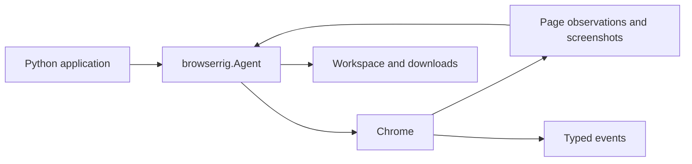

# Browserrig

Browserrig is an event-driven Chrome automation library for AI agents and Python applications. It combines direct browser access with a composable [Harnessed](https://github.com/mathisarends/harnessed/releases/tag/v0.11.0) agent, structured page observations, browser actions, and typed events.

Agents can navigate tabs, interact with DOM elements or screenshot coordinates, download and read files, and be paused or steered during a session. Chrome can be launched locally or connected through CDP.



## Quick start

Python 3.12+ and Chrome or Chromium are required. Install the package with the
provider extra you need:

```sh
python -m pip install "browserrig[openai]"
```

Set `OPENAI_API_KEY` in your environment, save the Python example below as
`agent.py`, and run `python agent.py`. The `anthropic`, `mcp`, and `otel` extras
enable the corresponding Harnessed integrations. For direct browser access
without a model provider, install `browserrig` without an extra.

The base installation includes document readers and local CPU OCR, including
ONNX Runtime and OpenCV. These native dependencies make the installation larger
than the wheel for Browserrig itself.

To run the examples from a source checkout instead (uv required):

```powershell
uv sync --locked --extra openai
Copy-Item .env.example .env
# Set OPENAI_API_KEY in .env.
uv run --env-file .env --extra openai python -m examples.openai_agent --headed
```

The example explores the Voyager missions. Use `--url` and `--task` to change the starting page and mission, `OPENAI_MODEL` to select a model, and `--quiet` to suppress streamed events. Add `--done` to allow standalone progress messages and require an explicit completion tool before the final answer. The final answer goes to stdout. Tests use scripted models and need no API key.

## Compose an agent

`Agent` is a browser-ready [Harnessed](https://github.com/mathisarends/harnessed) agent. Its plugins bring together page observations, tools, context management and the choreography of browser input. Configure the pieces you need while keeping the rest of the default kit:

```python
import asyncio

from harnessed import PolicyDecision
from harnessed.models.pydantic_ai import PydanticAIModel
from harnessed.plugins import Approvals
from pydantic_ai.models.openai import OpenAIResponsesModel

from browserrig import (
    Agent, Chrome, ContextCompaction, ImageContext, Observe,
    Screenshots, ScreenshotTrigger, UntilCompaction, WindowRatio,
)


async def main():
    agent = Agent(
        model=PydanticAIModel(OpenAIResponsesModel("gpt-6.1-terra")),
        browser=Chrome.launch(
            url="https://en.wikipedia.org/wiki/Voyager_program", headless=False,
        ),
        plugins=[
            Approvals(default=PolicyDecision.ALLOW),
            Observe(screenshots=Screenshots(trigger=ScreenshotTrigger.EACH_STEP)),
            ImageContext(UntilCompaction()),
            ContextCompaction(trigger=WindowRatio(0.8)),
        ],
    )
    async with agent.session() as session:
        await session.context.set("constraints", "Include source URLs.")
        result = await session.run("Compare the Voyager missions.", max_steps=20)
        print(result.text)


asyncio.run(main())
```

Install the `openai` extra and set `OPENAI_API_KEY` as in the quick start. The example captures a screenshot at each model step, keeps images until their steps are compacted, and summarizes older context when the model window reaches 80% (or at 100,000 tokens when its size is unknown). The session also carries application context across the task.

This example explicitly permits tool actions with `Approvals(default=PolicyDecision.ALLOW)`.
By default, actions with side effects require approval. Configure an approval
handler with `Approvals(approver=...)` when your application should ask before
acting; without a handler or an explicit allow policy, those actions are rejected.

Plugins replace matching defaults in place or add new capabilities; `without=(...)` removes defaults. By default, `InputPacing` moves the pointer and types at a person's pace, while `InputVisualization` stages actions for viewers through events such as cursor movement, highlights and browser UI. To run without that pacing and presentation, add `without=(InputPacing, InputVisualization)` to `Agent` (import both from `browserrig`). They can also be configured independently.

Sessions support streaming events, pausing, steering and resuming a running task. See the [agent guide](https://github.com/mathisarends/browserrig/blob/main/docs/agent-guide.md) and [browser composition](https://github.com/mathisarends/browserrig/blob/main/docs/browser-composition.md) for controls, context policies and extension points. For direct browser access or connecting to an existing Chrome instance, see [browser interaction](https://github.com/mathisarends/browserrig/blob/main/docs/browser-interaction.md).

Mount `plugins=[Done()]` to opt into [explicit completion and structured final
answers](https://github.com/mathisarends/browserrig/blob/main/docs/agent-guide.md#explicit-completion-and-output-formats). Without it,
ordinary text responses retain Harnessed's default completion behavior.

## Release status

Browserrig is an early 0.x release; public APIs may change between minor versions.
CI covers Python 3.12–3.14 on Windows and Linux, with real Chrome integration tests
on Linux. macOS is not covered by CI; select Chrome explicitly with
`Chrome.launch(executable=...)` or `BROWSERRIG_CHROME` there.

`Chrome.launch(...)` configures a Chrome plugin without starting a process. Chrome
starts when the agent session opens and stops when it closes. To use an existing
CDP browser, pass `browser=Chrome.connect(endpoint="http://localhost:9222")`;
closing the session leaves that browser running. Both factories return plugins
that also work directly in a Harnessed agent's `plugins=[...]` list.

Perspective-transformed frames and recovery from browser process crashes remain
limitations. See the [changelog](https://github.com/mathisarends/browserrig/blob/main/CHANGELOG.md)
for release notes.

## Documentation

| Guide | Contents |
| --- | --- |
| [Agent guide](https://github.com/mathisarends/browserrig/blob/main/docs/agent-guide.md) | Setup, action chains, prompts, sessions and controls |
| [Browser interaction](https://github.com/mathisarends/browserrig/blob/main/docs/browser-interaction.md) | Direct access, observations, input and page content |
| [Files and events](https://github.com/mathisarends/browserrig/blob/main/docs/files-and-events.md) | Downloads, workspace, file readers and event streams |
| [Browser composition](https://github.com/mathisarends/browserrig/blob/main/docs/browser-composition.md) | Configure and compose browser plugins |
| [Telemetry](https://github.com/mathisarends/browserrig/blob/main/docs/telemetry.md) | Local traces, configuration and troubleshooting |
| [Development](https://github.com/mathisarends/browserrig/blob/main/docs/development.md) | Setup, checks, tests and project status |
| [Harnessed telemetry feedback](https://github.com/mathisarends/browserrig/blob/main/docs/harnessed-telemetry-feedback.md) | Integration findings |

## License

[MIT](https://github.com/mathisarends/browserrig/blob/main/LICENSE).
