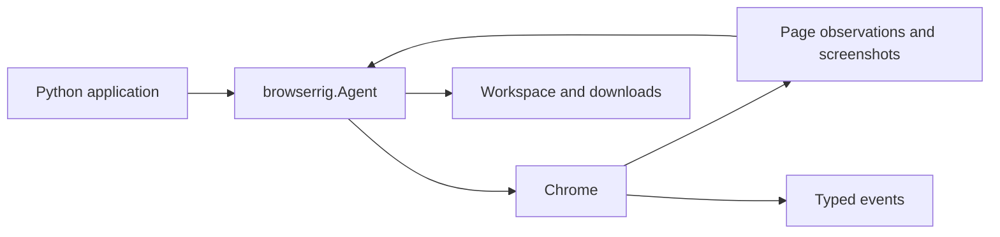

# Browserrig

Browserrig is an event-driven Chrome automation library for AI agents and Python applications. It combines direct browser access with a composable [Harnessed](https://github.com/mathisarends/harnessed/releases/tag/v0.10.0) agent, structured page observations, browser actions, and typed events.

Agents can navigate tabs, interact with DOM elements or screenshot coordinates, download and read files, and be paused or steered during a session. Chrome can be launched locally or connected through CDP.



## Quick start

From a checkout (Python 3.12+, uv, and Chrome required):

```powershell
uv sync --locked --extra openai
Copy-Item .env.example .env
# Set OPENAI_API_KEY in .env.
uv run --env-file .env --extra openai python -m examples.openai_agent --headed
```

The example explores the Voyager missions. Use `--url` and `--task` to change the starting page and mission, `OPENAI_MODEL` to select a model, and `--quiet` to suppress streamed events. Add `--done` to allow standalone progress messages and require an explicit completion tool before the final answer. The final answer goes to stdout. Tests use scripted models and need no API key.

## Use from Python

```python
from browserrig import ChromeBrowser, Launch, wait_for_page
from browserrig.scripts import PAGE_FACTS

async with ChromeBrowser(Launch(url="https://example.com")) as browser:
    tab = browser.active_tab
    await wait_for_page(tab)
    frame = await tab.main_frame()
    facts = await frame.run(PAGE_FACTS)
    print(facts.title)
```

For an LLM-powered agent, see the [agent guide](docs/agent-guide.md#browseragent). For connecting to an existing browser and controlling pages directly, see [browser interaction](docs/browser-interaction.md).

Mount `plugins=[Done()]` to opt into [explicit completion and structured final
answers](docs/agent-guide.md#explicit-completion-and-output-formats). Without it,
ordinary text responses retain Harnessed's default completion behavior.

## Documentation

| Guide | Contents |
| --- | --- |
| [Agent guide](docs/agent-guide.md) | Setup, action chains, prompts, sessions and controls |
| [Browser interaction](docs/browser-interaction.md) | Direct access, observations, input and page content |
| [Files and events](docs/files-and-events.md) | Downloads, workspace, file readers and event streams |
| [Browser composition](docs/browser-composition.md) | Configure and compose browser plugins |
| [Telemetry](docs/telemetry.md) | Local traces, configuration and troubleshooting |
| [Development](docs/development.md) | Setup, checks, tests and project status |
| [Harnessed telemetry feedback](docs/harnessed-telemetry-feedback.md) | Integration findings |
