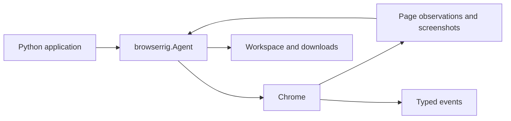

# Browserrig

Browserrig is an event-driven Chrome automation library for AI agents and Python applications. It combines direct browser access with a composable [Harnessed](https://github.com/mathisarends/harnessed/releases/tag/v0.16.0) agent, structured page observations, browser actions, and typed events.

Agents can navigate tabs, interact with DOM elements or screenshot coordinates, download and read files, and be paused or steered during a session. Chrome can be launched locally or connected through CDP.



## Quick start

Python 3.12+ and Chrome or Chromium are required. Install the package with the
provider extra you need:

```sh
python -m pip install "browserrig[openai]"
```

Set `OPENAI_API_KEY` in your environment, save the Python example below as
`agent.py`, and run `python agent.py`. The `anthropic`, `mcp`, and `otel` extras
enable the corresponding Harnessed integrations. For direct browser access
without a model provider, install `browserrig` without an extra.

The base installation reads plain text files only. Add the `files` extra for
document, spreadsheet, PDF and media readers, or the `ocr` extra for those readers
plus local CPU OCR (ONNX Runtime and OpenCV, a much larger download):

```sh
python -m pip install "browserrig[openai,files]"  # document readers
python -m pip install "browserrig[openai,ocr]"    # document readers and OCR
```

To run the examples from a source checkout instead (uv required):

Harnessed and all provider extras are pinned to the published `0.16.0` release,
with native ordinary-message input and explicit stream contexts.
Existing pre-0.16 conversation states and audit logs are incompatible; back up
old application data and start new stores. See the [upgrade notes](CHANGELOG.md).

GPT-6.1 Terra uses a 256,000-token application context limit for both ordinary
agents and benchmarks, with an 8,192-token output reserve and compaction at 80%.
The shared profile retains two steps, targets 40% input occupancy after compaction
and caps summary text at 8,192 tokens; see [task memory](docs/task-memory.md).

```powershell
uv sync --locked --extra openai
Copy-Item .env.example .env
# Set OPENAI_API_KEY in .env.
uv run --env-file .env --extra openai python -m examples.openai_agent --headed
```

The example explores the Voyager missions. Use `--url` and `--task` to change the starting page and mission, `OPENAI_MODEL` to select a model, and `--quiet` to suppress streamed events. Add `--done` to allow standalone progress messages and require an explicit completion tool before the final answer. The final answer goes to stdout. Tests use scripted models and need no API key.

## Compose an agent

`Agent` is a browser-ready [Harnessed](https://github.com/mathisarends/harnessed) agent. Its plugins bring together page observations, tools, context management and the choreography of browser input. Configure the pieces you need while keeping the rest of the default pack:

```python
import asyncio

from harnessed import PolicyDecision
from harnessed.models import UserMessage
from harnessed.models.pydantic_ai import PydanticAIModel
from harnessed.plugins import Approvals
from pydantic_ai.models.openai import OpenAIResponsesModel

from browserrig import (
    Agent,
    BrowserPerception,
    Chrome,
    ContextCompaction,
    ImageContext,
    Screenshots,
    ScreenshotTrigger,
    UntilCompaction,
    WindowRatio,
)


async def main():
    agent = Agent(
        model=PydanticAIModel(OpenAIResponsesModel("gpt-6.1-terra")),
        browser=Chrome.launch(
            url="https://en.wikipedia.org/wiki/Voyager_program",
            headless=False,
        ),
        plugins=[
            Approvals(default=PolicyDecision.ALLOW),
            BrowserPerception(
                screenshots=Screenshots(trigger=ScreenshotTrigger.EACH_STEP),
            ),
            ImageContext(UntilCompaction()),
            ContextCompaction(trigger=WindowRatio(0.8)),
        ],
    )
    async with agent.session() as session:
        await session.append_message(UserMessage("Include source URLs."))
        result = await session.run("Compare the Voyager missions.", max_steps=20)
        print(result.text)


asyncio.run(main())
```

Install the `openai` extra and set `OPENAI_API_KEY` as in the quick start. The example captures a screenshot at each model step, keeps images until their steps are compacted, and summarizes older context when the model window reaches 80% (or at 100,000 tokens when its size is unknown).

`await session.append_message(UserMessage(text))` appends background for subsequent model requests
without starting a turn or calling the model. Each call adds a separate message;
contributions follow normal conversation retention and compaction. Await it before
starting work that must see the contribution.

This example explicitly permits tool actions with `Approvals(default=PolicyDecision.ALLOW)`.
By default, actions with side effects require approval. Configure an approval
handler with `Approvals(approver=...)` when your application should ask before
acting; without a handler or an explicit allow policy, those actions are rejected.

Plugins replace matching defaults in place or add new capabilities; `without=(...)` removes defaults. By default, `InputPacing` moves the pointer and types at a person's pace, while `InputVisualization` stages actions for viewers through events such as cursor movement, highlights and browser UI. To run without that pacing and presentation, add `without=(InputPacing, InputVisualization)` to `Agent` (import both from `browserrig`). They can also be configured independently.

Sessions support streaming events, pausing, steering and resuming a running task. See the [agent guide](https://github.com/mathisarends/browserrig/blob/main/docs/agent-guide.md) and [browser composition](https://github.com/mathisarends/browserrig/blob/main/docs/browser-composition.md) for controls, context policies and extension points. For direct browser access or connecting to an existing Chrome instance, see [browser interaction](https://github.com/mathisarends/browserrig/blob/main/docs/browser-interaction.md).

Mount `plugins=[Done()]` to opt into [explicit completion and structured final
answers](https://github.com/mathisarends/browserrig/blob/main/docs/agent-guide.md#explicit-completion-and-output-formats). Without it,
ordinary text responses retain Harnessed's default completion behavior.

Mount `plugins=[Todos()]` to add an optional [task todo list](docs/todos.md).
Open plans are reminded after compaction or when they go stale, and survive
session restoration. Completed steps are agent reports,
not verified outcomes.

## Session videos

Add `VideoRecording()` to `Agent(plugins=[...])` to start recording when the
session opens. It uses cdpify's native `page.start_screen_recording()` and
`stop_screen_recording()` commands, follows the active tab, and creates
`.browserrig/recordings/<unique-id>/video.mp4` when the session closes. FFmpeg
must be on `PATH`; Chrome must support `Page.startScreenRecording`.

```python
from pathlib import Path
from browserrig import VideoRecording

# Include this plugin alongside your model and browser configuration:
recording = VideoRecording(Path(".browserrig/recordings"), padding=0.15)
# agent = Agent(model=..., plugins=[recording])
```

The existing `Activity` plugin supplies the cut times: model requests, context
compaction and pauses are removed, with a short margin around each cut. Concurrent
tool execution, page readiness and human handoffs remain visible. The same FFmpeg
pass also writes the uncut `original.mp4` (`result.original_path`), which joins
every capture in order without removing waits. Original native captures and
`timeline.json` are retained beside both videos. The recording
captures page content, including the iframe rendered by `InputVisualization()`.
Cursor motion, clicks, keyboard shortcuts, highlights and find results are visible
in Chrome and in the video. Native browser chrome is outside the capture.
Ordinary page screenshots omit application overlays; the recorder saves its segment
before they are hidden and resumes after restoration, keeping those phases out of the film.
The recording follows `browser.active_tab` when you open or activate a tab through
Browserrig, or close the active tab. Each switch saves a native capture; the captures
are joined in order into one `video.mp4`. Reactivating the current tab keeps its
capture running.
Wait boundaries also split native captures so sparse video frames cannot carry a
waiting scene into resumed work. The uncut film retains those wait segments.
Manual tab selection in Chrome's UI is not tracked; use `browser.tabs.activate(...)`
to select the tab that Browserrig controls and records.
Close tabs through Browserrig so their recordings can be saved before destruction.

The OpenAI example supports `--video .browserrig/recordings`. Hold
`session.scope[VideoRecording]` to read its `result` after session exit, or call
`await session.scope[VideoRecording].finish()` to stop and edit earlier. Each session
creates a separate output directory, including when the same agent is reused.

Run `uv run python -m examples.visualization --headed` for a local demonstration
without a model or API key. It saves a viewer screenshot, a clean observation
screenshot and a video under `.browserrig/visualization`.
See the [choreography gallery](docs/browser-choreography.md) for full captures,
the recording and renderer configuration.

## Release status

Browserrig is an early 0.x release; public APIs may change between minor versions.
CI covers Python 3.12–3.14 on Windows and Linux, with real Chrome integration tests
on Linux. macOS is not covered by CI; select Chrome explicitly with
`Chrome.launch(executable=...)` or `BROWSERRIG_CHROME` there.

`Chrome.launch(...)` configures a Chrome plugin without starting a process. Chrome
starts when the agent session opens and stops when it closes. To use an existing
CDP browser, pass `browser=Chrome.connect(endpoint="http://localhost:9222")`;
closing the session leaves that browser running. Both factories return plugins
that also work directly in a Harnessed agent's `plugins=[...]` list.

Perspective-transformed frames and recovery from browser process crashes remain
limitations. See the [changelog](https://github.com/mathisarends/browserrig/blob/main/CHANGELOG.md)
for release notes.

## Documentation

| Guide | Contents |
| --- | --- |
| [Agent guide](https://github.com/mathisarends/browserrig/blob/main/docs/agent-guide.md) | Setup, action chains, prompts, sessions and controls |
| [Task todos](docs/todos.md) | Optional task plan, reminders and session persistence |
| [Task memory](docs/task-memory.md) | Workspace checkpoints, recovery after compaction and correlated traces |
| [Browser interaction](https://github.com/mathisarends/browserrig/blob/main/docs/browser-interaction.md) | Direct access, observations, input and page content |
| [Files and events](https://github.com/mathisarends/browserrig/blob/main/docs/files-and-events.md) | Downloads, workspace, file readers and event streams |
| [Browser composition](https://github.com/mathisarends/browserrig/blob/main/docs/browser-composition.md) | Configure and compose browser plugins |
| [Telemetry](https://github.com/mathisarends/browserrig/blob/main/docs/telemetry.md) | Local traces, configuration and troubleshooting |
| [Development](https://github.com/mathisarends/browserrig/blob/main/docs/development.md) | Setup, checks, tests and project status |
| [Harnessed telemetry feedback](https://github.com/mathisarends/browserrig/blob/main/docs/harnessed-telemetry-feedback.md) | Integration findings |

## License

[MIT](https://github.com/mathisarends/browserrig/blob/main/LICENSE).
