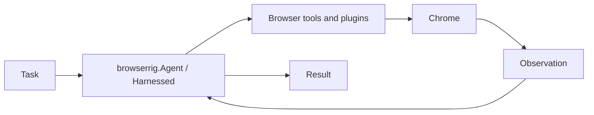

# Agent guide

[Back to README](../README.md)



## Agent

`browserrig.Agent` is Harnessed's `Agent` with browser capabilities:

```python
from harnessed import PolicyDecision
from harnessed.models.pydantic_ai import PydanticAIModel
from harnessed.plugins import Approvals
from pydantic_ai.models.openai import OpenAIResponsesModel

from browserrig import Agent, Chrome, TerminalEvents

agent = Agent(
    model=PydanticAIModel(OpenAIResponsesModel("gpt-6.1-terra")),
    browser=Chrome.launch(url="https://en.wikipedia.org/wiki/Voyager_program"),
    plugins=[Approvals(default=PolicyDecision.ALLOW), TerminalEvents()],
)
result = await agent.run(
    "Compare Voyager 1 and 2 and cite the source URLs.", max_steps=20
)
print(result.text)
```

`run()`, `session()`, and session controls remain native Harnessed APIs.
Wrap native Pydantic AI models with `PydanticAIModel(...)`; Harnessed enters and exits
the wrapper's resource context. Model strings remain supported. Explicitly supplied HTTP and provider SDK clients remain caller-owned.
Use `instructions=...` to replace the default caller text and `prompt=...` to
configure the prompt document or collection strategy. `plugins=[...]`
replaces the defaults it matches and adds the rest; `without=(...)` drops
defaults by type (see [Composing plugins](#composing-plugins)). Conversations
stay in memory; see
[Saving and restoring sessions](#saving-and-restoring-sessions).
By default, older steps are summarized once a request reaches 80% of the model's
context window (the default `TaskMemory(trigger=WindowRatio(0.8))`), so long runs do
not stop at the context limit. Many providers report no window; the trigger then
fires at 100k tokens (`WindowRatio(fallback_tokens=...)`), or pass
`PydanticAIModel(..., context_window=...)` to use the ratio. Pass your own
`TaskMemory(...)` from `browserrig` in `plugins` to tune it, or
`without=(ContextCompaction,)` to keep every step.
GPT-6.1 Terra uses a shared 256,000-token application context limit and an
8,192-token output reserve on both API and subscription runs, even if its adapter
reports no window. Its default compaction retains two steps, targets 40% input
occupancy and allows up to 8,192 summary tokens; see [task memory](task-memory.md).
Task memory asks the agent to save a concise workspace checkpoint before compaction
and read it afterward; see [task memory](task-memory.md). Passing plain
`ContextCompaction(...)` keeps native summarization without that protocol.
Without an `Approvals` plugin, Harnessed's default `ASK` policy applies; the example
above allows actions automatically. The constructor does not open Chrome or files.

## Composing plugins

`Agent` and `browser_plugins()` share one rule:

- A plugin that fills the same slot as a default
  replaces it in place, such as `BrowserPerception(...)`, `Readiness(...)`, `ImageContext(...)`
  or `ContextCompaction(...)`. Two plugins for the same default raise `PluginConflict`.
- Any other plugin is added after the defaults.
- `without=(...)` drops defaults by type; a type that is not a default raises
  `ValueError`.
- `None` entries are skipped, so optional plugins can be written inline.

```python
from browserrig import (
    Agent,
    InputVisualization,
    FileTools,
    BrowserPerception,
    InputPacing,
    Screenshots,
    ScreenshotTrigger,
)

agent = Agent(
    model=model,
    plugins=[
        BrowserPerception(screenshots=Screenshots(trigger=ScreenshotTrigger.EACH_STEP)),
        handoff if interactive else None,
    ],
    without=(InputPacing, InputVisualization, FileTools),
)
```

`browser_pack()` publishes the defaults as a native Harnessed `PluginPack`, including
its Markdown prompt strategy. It collects complete instruction blocks in the
final plugin-list order, including additional application plugins:

```python
from harnessed import Agent
from browserrig import FileTools, browser_pack

browser = browser_pack().without(FileTools)
agent = Agent(
    model=model,
    instructions="Complete the task.",
    plugins=[browser, MyPlugin()],
)
print(agent.describe())
```

Direct plugins override pack defaults by slot; sibling packs with conflicting slots
need an explicit override. `agent.describe()` reports origins, replacements and
exclusions without opening Chrome. `browser_plugins(*plugins, browser=..., without=...)`
remains available when a resolved flat list is needed. Native Harnessed agents
collect plugin instructions by default. Pass `SystemPrompt.from_plugins(format=...)`
only when adding fixed content or choosing a format.
Individual capabilities such as `Chrome`, `Readiness`, `BrowserPerception`, `Actions`, tool
plugins, `Nudges`, `Activity`, and `TerminalEvents` are also available directly.
`browser_plugins()` uses Harnessed's public `PluginPack.resolve()` with
`PluginPackPromptPolicy.OMIT`, omitting pack prompt strategies recursively while retaining
selected plugins' instructions and explicit `PromptRenderer` recipes. To inspect
the original pack's provenance before flattening:

```python
from harnessed import PluginPackPromptPolicy

resolved = browser.resolve(prompt=PluginPackPromptPolicy.INCLUDE)
print(resolved.description)
```

`resolved.plugins` is a flat tuple. Its separate `description` retains pack paths,
replacements and removals; passing the original pack to `Agent` preserves those
scopes in the agent's own description.

See [composing browser agents](browser-composition.md) for the explicit plugin API:
`Readiness(initial=..., ongoing=...)`, `BrowserPerception(capture=..., renderer=...,
screenshots=Screenshots(trigger=ScreenshotTrigger.EACH_STEP))` and
`ImageContext(TrimInBatches(max_images=6, min_images=3))` or
`ImageContext(UntilCompaction())`. Capture, rendering, image retention and
tool capabilities can be selected independently. `ScreenshotTrigger.ON_REQUEST`
captures only after a screenshot tool call. Configure extraction through `DomCapture(...)`.

`DomCapture()` describes visible controls plus a 1,000 CSS-pixel vertical buffer
above and below each visible document viewport. Previews are labelled separately;
their refs use normal scrolling and hit-testing before input. Screenshots and
their ref marks continue to cover the real viewport only. Set
`viewport_expansion=0` for a strict viewport observation. Hidden/inert content,
hard clipping and the current clip of inner scroll containers remain excluded.
Scroll containers are explicit targets with remaining wheel distances in each
direction. `scroll_element(ref=...)` moves only that list or carousel and stops at
its boundary; `scroll_page(...)` moves only the outer document. Both work
independently of cursor position and report their actual movement.

Element actions reveal their target before moving the cursor, including native
select/date updates, uploads and links that start downloads. Each aim refreshes
frame geometry so page-script scrolling and iframe movement use current viewport
coordinates. A hidden file input uses its explicitly associated rendered label
when available; inputs without a rendered target are assigned directly.

Observations include up to 3,000 characters of page text by default, prioritizing
the visible text before nearby context. Associated field descriptions are also
shown on their controls. `max_text_chars=0` restores controls-only output on dense
pages; `sparse_text_chars` still provides the small-page fallback unless set to
zero too. Comparison probes omit text excerpts so truncation does not interrupt
ordinary form filling. A newly invalid field stops an action chain before later
calls such as submission.
Shared plugin services use `needs(T)` for required lifetime bindings and
`observes(T)` for optional bindings from `harnessed.kernel`. Both bind before setup
and restart the activation when their provider changes. Move setup/teardown
injection into these fields. Tool and hook `Inject[T]` parameters stay call-scoped;
tool context parameters must explicitly use `Inject[ToolContext]`. Plugins and
runtime hooks use `SessionContext` from `harnessed.services`; application code
resolves services through `session.scope`.
Tool decorators declare model-facing descriptions independently of developer docstrings.
Use `timeout_seconds=` for tool declarations/registrations; a synchronous resolver
can select a deadline from the mounted plugin once per activation. `None` inherits
`AgentLoop(tool_timeout=...)`. Shell and approval timeouts keep their existing names.

Plugin recipes replay their explicit constructor arguments for every activation.
Higher-level plugins implement `async def setup(self, scope: PluginScope)` and
`async def teardown(self, scope: PluginScope)`, importing `PluginScope` from
`harnessed.kernel`. Deferred instruction factories receive this view too. It owns
resources and registrations; application composition uses full `session.scope`.
Plugins compose through the application or a `PluginPack`, rather than installing
other plugins during setup.
Constructors validate configuration; acquire resources in `setup` and register
cleanup with `scope.effect(...)`. Keep mount-owned mutable data in `PluginState`.
Direct tool calls need an active instance. In isolated tests, use
`harnessed.testing.mount_plugin(recipe, services=...)` to obtain one.

## Links and web search

The default system prompt tells the agent to follow observed links with
`click(ref=...)`, including search results and links in above/below previews.
The URL shown next to a link identifies its destination; the ref is the action
target. `click(ref=..., new_tab=True)` keeps the current page open.

When already on DuckDuckGo, use its observed search field to enter or revise the
query with `type_text(ref=..., text=...)`, then submit with `send_keys(key="Enter")`
or click the observed search button. Use `search(query=...)` to start a DuckDuckGo
web search from another site or when no usable search field is observed. Reserve
`navigate(url=...)` for an initial URL or a known destination without a usable
observed link ref.

## Action chains and stable tool kinds

Browserrig uses Harnessed's native scheduler for action chains. For forms, the
default instructions favor combining `type_text`, `select_option`, `set_date`,
and a final `click` in one model response when field refs and values are known.
The form instructions reserve intermediate observations for dependent choices,
such as new suggestions, options or validation results. `send_keys` can also
continue the chain. File
reads/writes, listings and content extraction can be chained. Browser tools run
sequentially against explicitly addressed tabs.

Navigation, search, history, reload, tab changes, file previews, scrolling, drags,
coordinate actions, JavaScript, uploads, dialogs, waiting and `screenshot`
use `ToolChain.STOP_AFTER`. The tool executes first; unstarted calls after it receive
`ToolStatus.SKIPPED`. The next model step can continue. Denied or disabled tools
retain Harnessed's native approval semantics and do not themselves stop the chain.

DOM inputs dynamically stop the chain after navigation, changed tabs, a changed
modal, a new alert, expanded controls or newly available interactive elements.
Typing that reveals suggestions retains the entered text and skips later calls.
Hover that reveals controls defers the original click and explicitly reports that
it was not dispatched. Ordinary value changes and cosmetic text updates do not
interrupt form filling. Comparison probes omit screenshots and preserve the
delivered observation, its element references and its new-element markers.
An incomplete or failed comparison stops the chain; it does not report successful
input as failed. Coordinate inputs require another observation after each input.

After `type_text`, native text inputs and textareas are read back. Unexpected
values, including formatting or rejected input, stop the chain before later calls
such as submission. The tool does not overwrite the page's result or retry typing.
Insertion with `clear=false` accounts for the field's selection when available.
Password and secret entry values are not read back by this check.

Observations retry once when a document or execution context changes during capture.
Both attempts share a ten-second capture budget; after a readiness timeout, capture
gets one second and does not retry. A screenshot failure or a stalled screenshot
keeps the usable DOM observation with an explicit limitation. A newly captured
document is marked degraded until its readiness has been confirmed. Browser input
and submissions are never replayed by this recovery.

Each built-in tool declares its own stable `ActionKind` through immutable
`BrowserToolMetadata`. Use `event.tool.metadata.get(BrowserToolMetadata)` in native
policy, execution or result-review hooks; the registration is captured when the
call is scheduled. Kinds are explicit constants, never derived from callback names
or signatures. In particular, `OPEN_TAB`, `SWITCH_TAB`, `CLOSE_TAB`, `LIST_TABS`,
`OPEN_FILE` and `OPEN_DOWNLOADED_FILE` are distinct. Coordinate clicks/drags and
DOM clicks/drags also have separate kinds. Existing semantic names `TYPE`, `PRESS`,
`SELECT`, `UPLOAD` and `JAVASCRIPT` identify their respective tools; date inputs use
`SET_DATE`. Click count remains an input parameter rather than changing tool kind.
Older `TAB` and `DOUBLE_CLICK` receipt values remain readable.

Import `ActionKind` from `browserrig.kinds` and `BrowserToolMetadata` or
`browser_tool` from `browserrig.tools`. The small `browser_tool` decorator requires
an explicit kind and defaults to ending the chain. Metadata stays process-local;
mutation receipts persist their stable action kind. `Actions.run()` returns the
native `ToolResult`, exposing both `.text` and `.break_chain` to direct callers.

## Explicit completion and output formats

`Done` is an optional plugin. While it is mounted, standalone text messages are
progress updates and the agent keeps working. The agent calls `done(success=True)`
alone once it has checked the last action's result, or `done(success=False)` when
the task could not be completed. This ends application-tool use; the next model
response supplies the final answer. Plain runs keep the user's requested format,
such as Markdown or CSV, through the final-answer instructions. These natural-language
format requests are instructions to the model, not schema validation.

```python
from browserrig import Agent, Done

agent = Agent(model=model, plugins=[Done()])
result = await agent.run("Compare the two products. Return a Markdown table.")
print(result.text)
```

With a step limit, `Done` also plans for the finish. On the last step that still
leaves room for a final answer (`max_steps - 1`, or `max_steps - 2` with
`FinalStepPolicy.SUMMARIZE`), the agent is told to call `done` now, and every other
tool is denied without approval prompts. After `done`, every tool is denied. Tool
definitions are never removed between these phases, so the prompt-cache prefix
stays valid. A structured `output=` contract in tool mode still adds the
`final_answer` tool after `done`.

Omit `Done()` to retain Harnessed's native behavior, where a text response without
tool calls ends the turn. `browser_plugins()` does not include it by default.
It also works with a plain Harnessed `Agent` or a runtime mount through
`async with session.use(Done(), section_delivery=SectionDelivery.CONTEXT): ...`.
Exiting the block restores the native completion and output behavior.

For a validated final format, pass the native `output=` contract when starting the
task. The schema is shown to the agent during work, but progress text remains
unconstrained. After `done`, Harnessed uses native structured output when supported
by the model, or its reserved `final_answer` tool otherwise. Validation and correction
retries remain native. Read the typed value from `result.output`; `result.text` may
be empty when the model returns the structured answer through a tool.

```python
from pydantic import BaseModel, Field


class ProductComparison(BaseModel):
    cheaper_product: str
    price_difference: float = Field(ge=0)
    sources: list[str]


result = await agent.run(
    "Compare the two products, including shipping.", output=ProductComparison
)
if result.completed:
    print(result.output.model_dump_json(indent=2))
```

Progress is available through the native event stream. The example below displays
all generated text, including the final answer; structured answers are available
on the terminal event's `result.output`.

```python
from harnessed.events import TextDeltaEvent, TurnResultEvent

async with agent.session() as session:
    async with session.stream("Compare the products. Return a Markdown table.") as run:
        async for event in run:
            if isinstance(event, TextDeltaEvent):
                print(event.text, end="", flush=True)
            elif isinstance(event, TurnResultEvent):
                result = event.result
        result = await run.result()
```

The work phase, the `done` call, the final response, and any correction attempts all
count against the existing step and token budgets. A limit or host stop still ends
the turn as incomplete; no extra model call bypasses those limits. A denied, failed,
or mixed-batch `done` does not enter finalization. Application tools cannot execute
after an accepted `done`, even if the model attempts to call one. The `success`
argument is the agent's assessment, recorded with its tool call; `result.completed`
continues to mean the turn ended normally, independently of task success.

## Step limits and optional final summaries

Configure Harnessed's native loop through the existing plugin interface:

```python
from harnessed.plugins import AgentLoop, FinalStepPolicy

agent = Agent(
    model=model,
    plugins=[AgentLoop(max_steps=20, final_step=FinalStepPolicy.SUMMARIZE)],
)
result = await agent.run("Investigate the page")
print(result.text)
```

This reserves the last available step for a text summary: a limit of 20 permits
at most 19 tool steps. Per-run `max_steps=` overrides determine the effective
limit. Summaries remain opt-in because they consume that allowance. A reserved
summary returns `completed=False` and `StopReason.MAX_STEPS`, and cannot execute
tools. For structured output, read `.text` on incomplete results;
`require_output()` raises `OutputUnavailable` unless the turn completed. `.output`
remains available for inspecting an already validated value. Native `PreStep` hooks
expose `max_steps`, `remaining_steps`,
`is_last_step` and `is_final_step`; manually constructed events require `max_steps=`.

## System prompts and optional MCP tools

`browserrig.Agent(instructions="...")` prepends caller text to the browser pack's
Markdown prompt. Use `instructions=None` to omit caller text. Complete plugin
blocks follow the final configured plugin-list order: observations, element refs,
page-content trust and screenshots; then coordinates and action chains; then files
and application plugins. Slot replacements keep their inherited position, and
removed plugins contribute nothing. Setup dependencies do not change this order.
Put policy plugins and `Done()` at their intended positions in the list; put
`Done()` last to close with completion guidance. `print(agent.prompt)` lists the
resolved content and origins. To choose another format, pass an explicit strategy:

```python
from harnessed import PromptFormat, SystemPrompt
from browserrig import Agent

agent = Agent(
    instructions="Complete the requested browser task using the observed page state.",
    prompt=SystemPrompt.from_plugins(
        format=PromptFormat.XML,
    ),
)
print(agent.prompt)
```

Each plugin provides one synchronous `instructions(self) -> SystemPrompt` method.
`BrowserPerception.instructions()` combines configuration-dependent page-state and element-ref
guidance with the page-content trust rules. `PointerTools`, `ImageContext`,
`Actions`, `FileTools`, `Secrets`, `HumanHandoff` and `Done` return complete blocks
too. Single-tool guidance remains in tool descriptions. Override the method to
replace a plugin's entire block, or return `SystemPrompt()` to omit its guidance.
Store static text in module constants; the method uses configuration only and
runs once per selected plugin when constructing the agent, before sessions open.
Use `Instructions.from_file(...)` or `Instructions.from_factory(...)` inside the
returned document for session-owned content and effects.

`prompt=` overrides the pack's strategy. `SystemPrompt.from_plugins(...)` collects
selected plugin instructions; a document constructed with `SystemPrompt(...)`
omits them. `print(agent.prompt)` reports omitted plugins.
Fixed content passed to `from_plugins(...)` follows caller text and precedes all
plugin blocks. `None` content parts and plugin entries are skipped. The outer
document's format controls all nested content.
For manual compositions, configure `BrowserPerception` independently of `Readiness` and add
`ImageContext()` to deliver captured images. Configure DOM observation settings
through `BrowserPerception(capture=DomCapture(...))`; readiness is configured separately.
Use `await session.prompt.render()` to inspect the exact session system text.

Plugins mounted through `session.use()` require an explicit choice when they declare
sections: `section_delivery=SectionDelivery.CONTEXT` delivers guidance until the
mount closes or suspends; `SectionDelivery.IGNORE` skips it. Import `SectionDelivery`
from `harnessed`. The fixed system prompt stays unchanged.

Harnessed 0.16 uses state format 3, checkpoint/JSON-store format 3 and audit
envelope version 6. Earlier conversation states and audit envelopes are rejected
without automatic migration; retain their original application environment to
read them and start new stores. See
[upgrade notes](../CHANGELOG.md) for all Browserrig API changes.

Install the optional MCP client with `uv sync --locked --extra openai --extra mcp`.
Harnessed and all provider extras are pinned to the published 0.16.0 release,
including `session.append_message(UserMessage(...))`. Add MCP servers through
the native plugin:

```python
from harnessed.plugins.mcp import MCP

agent = Agent(
    plugins=[
        MCP.http("catalog", url="http://localhost:8000/mcp", include_tools=["search"])
    ],
)
```

The MCP extra now uses SDK 2.3+ and FastMCP 4.1.2+. Custom auth uses
`httpx2.Auth`; custom transports forward `transport_options`, OAuth callbacks
return `AuthorizationCodeResult`, and machine credentials bind with `issuer=`.
Multi-round input does not automatically repeat an approved tool call. See the
linked MCP guide for migration details.

`MCP.stdio("catalog", command=..., args=[...])` starts a local server instead.
Connections belong to each session, tool names are prefixed (for example
`catalog__search`), and existing approval policies apply. See the
[Harnessed MCP guide](https://github.com/mathisarends/harnessed/blob/v0.16.0/docs/guides/mcp.md).

Harnessed closes failed MCP transports, hides their tools, wakes pending
calls and drains owned tasks. Failed operations are not retried automatically;
replace a failed connection with a fresh mount. Ordinary tool `isError` results
keep the connection usable. HTTP termination has a five-second inactivity timeout.

## Plugin validation and diagnostics

Browser plugins declare their required services explicitly, including dependencies
used only by tool or hook parameters. Custom plugins must do the same:

```python
from harnessed import Plugin
from harnessed.kernel import needs
from browserrig import Browser


class Extension(Plugin):
    browser = needs(Browser)
```

`Agent` keeps Harnessed's strict startup validation by default. Missing
services raise `PluginDependencyError` from `harnessed.errors` before the runtime
starts, including through `run()`. Its `.issues` tuple identifies each waiting
plugin through `.plugin` and its missing service keys through `.missing`.

For plugins deliberately waiting for services added later, pass
`plugin_validation=PluginValidation.WARN` to `Agent`, importing
`PluginValidation` from `harnessed`. This emits `PluginDependencyWarning` with the
same structured issues and retains waiting plugins for later activation; setup
failures still propagate. Use `async with session.use(...)` for scoped services or
`await session.mount(...)` when managing the handle manually.
For standalone kernel compositions, call `await ctx.settle()` followed by
`ctx.plugin_diagnostics()` to inspect waiting plugins, including blocked dependents.

## Saving and restoring sessions

Sessions stay in memory by default. To save conversations automatically and
reopen them by application-owned ID, configure Harnessed 0.16.0's native store:

```python
from pathlib import Path
from harnessed.integrations.json import JsonSessionStore
from browserrig import Agent, Files, LocalWorkspace

agent = Agent(
    model=model,
    store=JsonSessionStore(root=Path(".browserrig/sessions")),
    plugins=[Files(LocalWorkspace(".browserrig/workspace"))],
)
async with agent.session(id="voyager") as session:
    await session.run("Find the Voyager launch dates.", max_steps=20)

# A later request or process can open the same conversation.
async with agent.session(id="voyager") as session:
    result = await session.run("Compare their trajectories.", max_steps=20)
```

`JsonSessionStore` ships in the base package. Storage is opt-in; no session files
are written without a configured store, and `session(id=...)` requires one.
An awaited run commits its terminal state, `await session.flush()` commits pending
state, and closing drains the writer. Each reopened session creates fresh browser
connections and plugin state. Browser tabs, DOM refs, handoff
callbacks and pending Python handles are not restored. Reuse a workspace directory
when files and downloads must survive closure; those files are separate from the
checkpoint. Run `uv run python -m examples.session_store` for a local smoke example.

An application-owned repository can implement `SessionStore` from
`harnessed.sessions`. `save_session(id, commit, expected_revision=...)` receives a
typed `SessionCommit`: atomically save `commit.checkpoint` and any domain message
projections of its ordered `commit.changes`. Load with
`StoredSession(checkpoint, revision)`. Changes include new durable Browserrig events;
live token deltas and input animations remain transient. The bundled JSON store
keeps the current checkpoint, not a complete message archive. Applications own
store lifetime and coordinate execution per conversation; revision checks prevent
lost updates but cannot prevent duplicate external browser actions.

A deliberately paused stored session remains paused after closing and reopening.
Use `agent.session(id=..., restore_outputs=[YourOutputType])` before calling
`resume()` for pending structured work, including `Done()` finalization. Validators
and the same event-declaring plugins must be configured again. After an unexpected
interruption, Harnessed repairs incomplete work without replaying external tool
actions. A reopened browser still starts fresh; persistence does not restore the
previous page or its interaction state.

Explicit `SessionState` continuation remains available without a store. Save
`result.state`, or `session.snapshot()` between turns, and pass it back to `run` or
`session`:

```python
from harnessed import SessionState

result = await agent.run("Find the Voyager launch dates.", max_steps=20)
saved = result.state.to_json()

result = await agent.run(
    "Now compare their trajectories.", state=SessionState.from_json(saved), max_steps=20
)
```

The state holds the conversation, including the screenshot bytes it still
references; `session.assets.read(ref)` retrieves them. It holds no browser, plugin
state or event log: a restored session launches a fresh browser, and queued hints
and activity intervals start empty. JavaScript tools remain blocked whenever
the restored agent is configured with secrets.
Conversation snapshots use format **3**; execution checkpoints and JSON store
envelopes use format **3**, and audit envelopes use version **6**. Earlier formats,
old JSONL stores and raw `SessionState` JSON cannot be opened as new store files.
Keep legacy data separate;
there is no automatic migration. See the
[Harnessed sessions guide](https://github.com/mathisarends/harnessed/blob/v0.16.0/docs/guides/sessions.md)
for atomic repository adapters, recovery and storage details.

Custom models expose immutable `GenerationSettings` from `harnessed.models`.
Pass per-turn overrides with `session.run(..., settings=GenerationSettings(...))`;
`max_tokens` belongs in settings. Message types are now `SystemMessage`,
`UserMessage`, `AssistantMessage` and `ToolMessage`; selected model identity lives
on `ModelRequestedEvent.model`. See the
[migration guide](https://github.com/mathisarends/harnessed/blob/v0.8.0/Changelog.md).

## Session controls

Inside an `async with agent.session() as session:` block:

```python
from harnessed.models import UserMessage

handle = await session.submit("Inspect this page.")
await session.pause()
await session.inbox.steer("Focus on the navigation.")
await session.append_message(UserMessage("Do not submit forms."))
await session.resume()
result = await handle.result()
```

Pausing waits for a complete step boundary and leaves Chromium running.
`session.stop()` ends the session gracefully; `session.abort()` interrupts it
immediately. Resuming observes the current page again. Activity tracking uses
events rather than an LLM decorator.

`await session.append_message(UserMessage(content))` is the session API for contributing
background without starting a turn, waking an idle agent or invoking the model.
Each call appends a user-role text message, including repeated text. Requests
assembled after the write see it; an in-flight request is unchanged. Await it
before starting work that depends on the contribution. With a configured store,
the contribution is committed before the method returns.

Contributions remain in conversation history across turns and session restoration,
subject to ordinary compaction; older contributions may be summarized. Inspect
retained input through `session.messages` or `session.snapshot().history`.
The former `session.context.set(name, value)`, `add_context(text)` and
`remove(name)` APIs are removed. Use `append_message(UserMessage(value))` for
additive background and `instructions=` for fixed rules. For changing facts,
write a `PrepareRequest` hook that returns `request.append_message(UserMessage(...))`;
these messages affect only the current request and are not durable conversation input.

```powershell
uv run --env-file .env --extra openai python -m examples.controls
```
