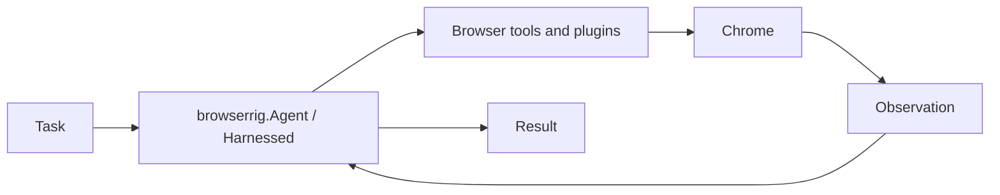

# Agent guide

[Back to README](../README.md)



## Agent

`browserrig.Agent` is Harnessed's `Agent` with browser capabilities:

```python
from harnessed import PolicyDecision
from harnessed.models.pydantic_ai import PydanticAIModel
from harnessed.plugins import Approvals
from pydantic_ai.models.openai import OpenAIResponsesModel

from browserrig import Agent, Launch, TerminalEvents

agent = Agent(
    model=PydanticAIModel(OpenAIResponsesModel("gpt-6.1-terra")),
    browser=Launch(url="https://en.wikipedia.org/wiki/Voyager_program"),
    plugins=[Approvals(default=PolicyDecision.ALLOW), TerminalEvents()],
)
result = await agent.run("Compare Voyager 1 and 2 and cite the source URLs.", max_steps=20)
print(result.text)
```

`run()`, `session()`, and session controls remain native Harnessed APIs.
Wrap native Pydantic AI models with `PydanticAIModel(...)`; Harnessed enters and exits
the wrapper's resource context. Model strings remain supported. Explicitly supplied HTTP and provider SDK clients remain caller-owned.
Use `system_prompt=...` to replace the default instruction. `plugins=[...]`
replaces the defaults it matches and adds the rest; `without=(...)` drops
defaults by type (see [Composing plugins](#composing-plugins)). Conversations
stay in memory; see
[Saving and restoring sessions](#saving-and-restoring-sessions).
By default, older steps are summarized once a request reaches 80% of the model's
context window (the default `Compaction(trigger=WindowRatio(0.8))`), so long runs do
not stop at the context limit. Many providers report no window; the trigger then
fires at 100k tokens (`WindowRatio(fallback_tokens=...)`), or pass
`PydanticAIModel(..., context_window=...)` to use the ratio. Pass your own
`Compaction(...)` from `harnessed.plugins` in `plugins` to tune it, or
`without=(Compaction,)` to keep every step.
Without an `Approvals` plugin, Harnessed's default `ASK` policy applies; the example
above allows actions automatically. The constructor does not open Chrome or files.

## Composing plugins

`Agent` and `browser_plugins()` share one rule:

- A plugin that fills the same slot as a default
  replaces it in place, such as `Observe(...)`, `Readiness(...)`, `ImageContext(...)`
  or `Compaction(...)`. Two plugins for the same default raise `PluginConflict`.
- Any other plugin is added after the defaults.
- `without=(...)` drops defaults by type; a type that is not a default raises
  `ValueError`.
- `None` entries are skipped, so optional plugins can be written inline.

```python
from browserrig import (
    Agent,
    Choreography,
    FileTools,
    Observe,
    Pacing,
    Screenshots,
    ScreenshotTrigger,
)

agent = Agent(
    model=model,
    plugins=[
        Observe(screenshots=Screenshots(trigger=ScreenshotTrigger.EACH_STEP)),
        handoff if interactive else None,
    ],
    without=(Pacing, Choreography, FileTools),
)
```

`browser_kit()` publishes the defaults as a native Harnessed `Kit`. Use it with
a plain Harnessed agent and place its instructions explicitly:

```python
from harnessed import Agent, PluginInstructions, SystemPrompt
from browserrig import FileTools, browser_kit

browser = browser_kit().without(FileTools)
agent = Agent(
    model=model,
    plugins=[browser, MyPlugin()],
    system_prompt=SystemPrompt("Complete the task.", browser.instructions, PluginInstructions()),
)
print(agent.describe())
```

Direct plugins override kit defaults by slot; sibling kits with conflicting slots
need an explicit override. `agent.describe()` reports origins, replacements and
exclusions without opening Chrome. `browser_plugins(*plugins, browser=..., without=...)`
remains available when a resolved flat list is needed; place its instructions with
`SystemPrompt("Complete the task.", PluginInstructions())`.
Individual capabilities such as `Chrome`, `Readiness`, `Observe`, `Actions`, tool
plugins, `Nudges`, `Activity`, and `TerminalEvents` are also available directly.
See [composing browser agents](browser-composition.md) for the explicit plugin API:
`Readiness(initial=..., ongoing=...)`, `Observe(capture=..., renderer=...,
screenshots=Screenshots(trigger=ScreenshotTrigger.EACH_STEP))` and
`ImageContext(TrimInBatches(max_images=6, min_images=3))` or
`ImageContext(UntilCompaction())`. Capture, rendering, image retention and
tool capabilities can be selected independently. `ScreenshotTrigger.ON_REQUEST`
captures only after a screenshot tool call. Configure extraction through `DomCapture(...)`.
Shared plugin services use `dependency(T)` from `harnessed.kernel` and `provides=True`; explicit
`needs=(...)` declarations control waiting, teardown, and restart when a provider changes.
Dependency fields bind values and declare lifetime requirements. Call-scoped
`Inject[T]` parameters still require explicit `needs` for lifetime requirements. Optional services resolve
on each hook invocation and remain optional unless explicitly listed in `needs`.
Tool decorators declare model-facing descriptions independently of developer docstrings.

Plugin recipes replay their explicit constructor arguments for every activation.
Constructors validate configuration; acquire resources in `setup` and register
cleanup with `ctx.effect(...)`. Keep mount-owned mutable data in `PluginState`.
Direct tool calls need an active instance. In isolated tests, use
`harnessed.testing.mount_plugin(recipe, services=...)` to obtain one.

## Action chains and stable tool kinds

Browserrig uses Harnessed's native scheduler for action chains. Deterministic
form filling can combine `type_text`, `select_option`, `set_date`, and a final
`click` in one model response. `send_keys` can also continue the chain. File
reads/writes, listings and content extraction can be chained. Browser tools run
sequentially against explicitly addressed tabs.

Navigation, search, history, reload, tab changes, file previews, scrolling, drags,
coordinate actions, JavaScript, uploads, dialogs, waiting and `screenshot`
use `ToolChain.STOP_AFTER`. The tool executes first; unstarted calls after it receive
`ToolStatus.SKIPPED`. The next model step can continue. Denied or disabled tools
retain Harnessed's native approval semantics and do not themselves stop the chain.

DOM inputs dynamically stop the chain after navigation, changed tabs, a changed
modal, a new alert, expanded controls or newly available interactive elements.
Typing that reveals suggestions retains the entered text and skips later calls.
Hover that reveals controls defers the original click and explicitly reports that
it was not dispatched. Ordinary value changes and cosmetic text updates do not
interrupt form filling. Comparison probes omit screenshots and preserve the
delivered observation, its element references and its new-element markers.
An incomplete or failed comparison stops the chain; it does not report successful
input as failed. Coordinate inputs require another observation after each input.

Each built-in tool declares its own stable `ActionKind` through immutable
`BrowserToolMetadata`. Use `event.tool.metadata.get(BrowserToolMetadata)` in native
policy, execution or result-review hooks; the registration is captured when the
call is scheduled. Kinds are explicit constants, never derived from callback names
or signatures. In particular, `OPEN_TAB`, `SWITCH_TAB`, `CLOSE_TAB`, `LIST_TABS`,
`OPEN_FILE` and `OPEN_DOWNLOADED_FILE` are distinct. Coordinate clicks/drags and
DOM clicks/drags also have separate kinds. Existing semantic names `TYPE`, `PRESS`,
`SELECT`, `UPLOAD` and `JAVASCRIPT` identify their respective tools; date inputs use
`SET_DATE`. Click count remains an input parameter rather than changing tool kind.
Older `TAB` and `DOUBLE_CLICK` receipt values remain readable.

Import `ActionKind` from `browserrig.kinds` and `BrowserToolMetadata` or
`browser_tool` from `browserrig.tools`. The small `browser_tool` decorator requires
an explicit kind and defaults to ending the chain. Metadata stays process-local;
mutation receipts persist their stable action kind. `Actions.run()` returns the
native `ToolResult`, exposing both `.text` and `.break_chain` to direct callers.

## Explicit completion and output formats

`Done` is an optional plugin. While it is mounted, standalone text messages are
progress updates and the agent keeps working. The agent calls `done(success=True)`
alone once it has checked the last action's result, or `done(success=False)` when
the task could not be completed. This ends application-tool use; the next model
response supplies the final answer. Plain runs keep the user's requested format,
such as Markdown or CSV, through the final-answer instructions. These natural-language
format requests are instructions to the model, not schema validation.

```python
from browserrig import Agent, Done

agent = Agent(model=model, plugins=[Done()])
result = await agent.run("Compare the two products. Return a Markdown table.")
print(result.text)
```

Omit `Done()` to retain Harnessed's native behavior, where a text response without
tool calls ends the turn. `browser_plugins()` does not include it by default.
It also works with a plain Harnessed `Agent` or a runtime mount through
`session.use(Done(), section_delivery=SectionDelivery.CONTEXT)`; closing the mount
restores the native completion and output behavior.

For a validated final format, pass the native `output=` contract when starting the
task. The schema is shown to the agent during work, but progress text remains
unconstrained. After `done`, Harnessed uses native structured output when supported
by the model, or its reserved `final_answer` tool otherwise. Validation and correction
retries remain native. Read the typed value from `result.output`; `result.text` may
be empty when the model returns the structured answer through a tool.

```python
from pydantic import BaseModel, Field


class ProductComparison(BaseModel):
    cheaper_product: str
    price_difference: float = Field(ge=0)
    sources: list[str]


result = await agent.run(
    "Compare the two products, including shipping.", output=ProductComparison
)
if result.completed:
    print(result.output.model_dump_json(indent=2))
```

Progress is available through the native event stream. The example below displays
all generated text, including the final answer; structured answers are available
on the terminal event's `result.output`.

```python
from harnessed.events import TextDeltaEvent, TurnFinishedEvent

async with agent.session() as session:
    async for event in session.stream("Compare the products. Return a Markdown table."):
        if isinstance(event, TextDeltaEvent):
            print(event.text, end="", flush=True)
        elif isinstance(event, TurnFinishedEvent):
            result = event.result
```

The work phase, the `done` call, the final response, and any correction attempts all
count against the existing step and token budgets. A limit or host stop still ends
the turn as incomplete; no extra model call bypasses those limits. A denied, failed,
or mixed-batch `done` does not enter finalization. Application tools cannot execute
after an accepted `done`, even if the model attempts to call one. The `success`
argument is the agent's assessment, recorded with its tool call; `result.completed`
continues to mean the turn ended normally, independently of task success.

## Step limits and optional final summaries

Configure Harnessed's native loop through the existing plugin interface:

```python
from harnessed.plugins import AgentLoop, FinalStepPolicy

agent = Agent(
    model=model,
    plugins=[AgentLoop(max_steps=20, final_step=FinalStepPolicy.SUMMARIZE)],
)
result = await agent.run("Investigate the page")
print(result.text)
```

This reserves the last available step for a text summary: a limit of 20 permits
at most 19 tool steps. Per-run `max_steps=` overrides determine the effective
limit. Summaries remain opt-in because they consume that allowance. A reserved
summary returns `completed=False` and `StopReason.MAX_STEPS`, and cannot execute
tools. For structured output, read `.text` on incomplete results; `.output` raises
`OutputUnavailable`. Native `PreStep` hooks expose `max_steps`, `remaining_steps`,
`is_last_step` and `is_final_step`; manually constructed events require `max_steps=`.

## System prompts and optional MCP tools

`browserrig.Agent(system_prompt="...")` places browser kit instructions and remaining
plugin instructions automatically, including with `system_prompt=None`.
For titled Markdown or XML, pass a native `SystemPrompt`:

```python
from harnessed import PluginInstructions, PromptFormat, SystemPrompt
from browserrig import Agent

agent = Agent(
    system_prompt=SystemPrompt(
        "Complete the requested browser task using the observed page state.",
        PluginInstructions(),
        format=PromptFormat.MARKDOWN,
    ),
)
print(agent.prompt)
```

`Observe` declares configuration-dependent `page_state` and `refs` sections, plus
the shared `trust` section. DOM guidance follows screenshot, mark and page-text
settings; coordinate tools describe how image pixels map to the viewport.
`PointerTools.coordinates`, `ImageContext.usage` and `FileTools.usage` describe shared workflows.
Single-tool instructions live in tool descriptions.

With a custom `browser_plugins()` composition, use the configured recipes' section
attributes in `SystemPrompt(*parts, exclude=...)` to reorder or replace
individual instructions. `PluginInstructions()` places the remaining declarations.
An explicit `SystemPrompt` follows Harnessed's strict placement rules: every
selected instruction must be placed or excluded. Declare content with `Instructions`
or `@instructions`.
For manual compositions, configure `Observe` independently of `Readiness` and add
`ImageContext()` to deliver captured images. Configure DOM observation settings
through `Observe(capture=DomCapture(...))`; readiness is configured separately.
Use `await session.prompt.render()` to inspect the exact session system text.

Plugins mounted through `session.use()` require an explicit choice when they declare
sections: `section_delivery=SectionDelivery.CONTEXT` delivers guidance until the
mount closes or suspends; `SectionDelivery.IGNORE` skips it. Import `SectionDelivery`
from `harnessed`. The fixed system prompt stays unchanged.

Install the optional MCP client with `uv sync --locked --extra openai --extra mcp`.
All Harnessed extras are pinned to **0.9.0**. Add MCP servers through the native plugin:

```python
from harnessed.plugins.mcp import MCP

agent = Agent(
    plugins=[MCP.http("catalog", url="http://localhost:8000/mcp", include_tools=["search"])],
)
```

`MCP.stdio("catalog", command=..., args=[...])` starts a local server instead.
Connections belong to each session, tool names are prefixed (for example
`catalog__search`), and existing approval policies apply. See the
[Harnessed MCP guide](https://github.com/mathisarends/harnessed/blob/v0.9.0/docs/guides/mcp.md).

Harnessed closes failed MCP transports, hides their tools, wakes pending
calls and drains owned tasks. Failed operations are not retried automatically;
replace a failed connection with a fresh mount. Ordinary tool `isError` results
keep the connection usable. HTTP termination has a five-second inactivity timeout.

## Plugin validation and diagnostics

Browser plugins declare their required services explicitly, including dependencies
used only by tool or hook parameters. Custom plugins must do the same:

```python
from harnessed import Plugin
from harnessed.kernel import dependency
from browserrig import Browser


class Extension(Plugin):
    browser = dependency(Browser)
```

`Agent` keeps Harnessed's strict startup validation by default. Missing
services raise `PluginDependencyError` from `harnessed.errors` before the runtime
starts, including through `run()`. Its `.issues` tuple identifies each waiting
plugin through `.plugin` and its missing service keys through `.missing`.

For plugins deliberately waiting for services added later, pass
`plugin_validation=PluginValidation.WARN` to `Agent`, importing
`PluginValidation` from `harnessed`. This emits `PluginDependencyWarning` with the
same structured issues and retains waiting plugins for later activation; setup
failures still propagate. Add services through native `session.use()` as usual.
For standalone kernel compositions, call `await ctx.settle()` followed by
`ctx.plugin_diagnostics()` to inspect waiting plugins, including blocked dependents.

## Saving and restoring sessions

Harnessed 0.8.0 replaces session stores with an explicit `SessionState`. Save
`result.state`, or `session.snapshot()` between turns, and pass it back to `run` or
`session`:

```python
from harnessed import SessionState

result = await agent.run("Find the Voyager launch dates.", max_steps=20)
saved = result.state.to_json()

result = await agent.run(
    "Now compare their trajectories.", state=SessionState.from_json(saved), max_steps=20
)
```

The state holds the conversation, including the screenshot bytes it still
references; `session.assets.read(ref)` retrieves them. It holds no browser, plugin
state or event log: a restored session launches a fresh browser, and queued hints,
the JavaScript lock after secret entry, and activity intervals start empty.
`session_directory` and the JSONL stores of Harnessed 0.7.0 are gone; existing
`.browserrig/sessions*` directories are left untouched and are not migrated.

Custom models expose immutable `GenerationSettings` from `harnessed.models`.
Pass per-turn overrides with `session.run(..., settings=GenerationSettings(...))`;
`max_tokens` belongs in settings. Message types are now `SystemMessage`,
`UserMessage`, `AssistantMessage` and `ToolMessage`; selected model identity lives
on `ModelRequestedEvent.model`. See the
[migration guide](https://github.com/mathisarends/harnessed/blob/v0.8.0/Changelog.md).

## Session controls

Inside an `async with agent.session() as session:` block:

```python
handle = await session.submit("Inspect this page.")
await session.pause()
await session.steer("Focus on the navigation.")
await session.context.set("constraints", "Do not submit forms.")
await session.resume()
result = await handle.result()
```

Pausing waits for a complete step boundary and leaves Chromium running.
`session.stop()` ends the session gracefully; `session.abort()` interrupts it
immediately. Resuming observes the current page again. Activity tracking uses
events rather than an LLM decorator.

```powershell
uv run --env-file .env --extra openai python -m examples.controls
```
