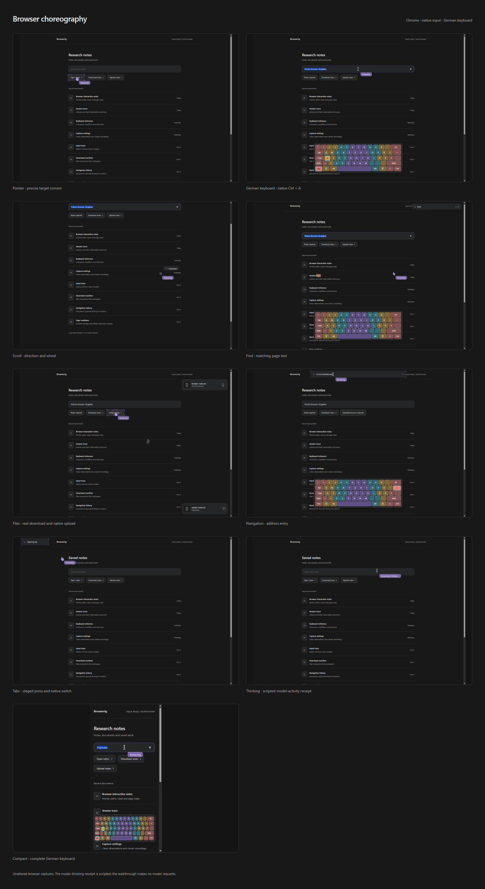

# Browser choreography and video

[Back to README](../README.md) · [Input contracts](browser-interaction.md#input-choreography)

`Choreography` stages input, browser UI and work receipts as live events; it draws
nothing itself. `ChoreographyOverlay` consumes those events and renders cursor,
keyboard, targets and action feedback inside the active Chrome tab. The live viewer
and native recording see the same page presentation; native browser toolbars are
outside the capture. Both are browser defaults.



[Play the Chrome recording](media/choreography/demo.mp4). These captures come from
the local walkthrough with real browser input and a scripted thinking receipt;
it makes no model calls.

## Configure or reproduce

```python
from browserrig import ChoreographyOverlay

overlay = ChoreographyOverlay(name="Research", keyboard_layout="de", theme="dark")
```

Mount `overlay` in `Agent(plugins=[...])`. Layouts are `en`/`de`, themes are
`dark`/`light`/`auto`. Pass `without=(ChoreographyOverlay,)` to keep only the
events for an [external viewer](#external-viewers). The overlay draws only what
`Choreography` emits, so it requires that plugin. Input pacing is controlled
separately by `InputPacing`.

```powershell
uv run python -m examples.visualization --headed --layout de --theme dark
```

Requires FFmpeg and Chrome supporting native Page recording. Omit `--headed` for
headless mode. `--directory` selects output for PNGs, gallery, manifest, timeline
and recordings. Ordinary model screenshots omit viewer surfaces; see
[overlay behavior](browser-composition.md#browser-owned-presentation).

## Model-written action labels

Ask the model for a short action label on each tool call and receive redacted
display events by adding `ActionLabels`:

```python
from browserrig import ActionLabels, Agent

agent = Agent(plugins=[ActionLabels()])
```

This opt-in registers the `ActionLabel` envelope and adds `action_label` to tool
schemas, including tools from other plugins and MCP servers. It costs extra
output tokens per call. The envelope is
validated and removed before the tool runs; tool implementations do not change.
Missing or invalid labels are dropped by default and the call still runs.
Without the plugin, schemas and presentation stay unchanged. For a native
Harnessed agent, compose `plugins=[browser_pack(), ActionLabels()]`;
no separate pack flag is needed.

Hosts access the label directly in their stream's `match`:

```python
from browserrig.choreography import ToolCallPresentedEvent

async with agent.session() as session:
    async with session.stream("Read the annual report") as stream:
        async for event in stream:
            match event:
                case ToolCallPresentedEvent() as event:
                    print(event.envelope.action_label)
```

`ToolCallPresentedEvent` carries `call_id`, `tool_name`, `phase`
(`ToolCallPhase.REQUESTED` or `FINISHED`) and `envelope.action_label`. Finished
calls also include their `ToolStatus` in `status`, including errors, denials and
cancellation. Missing or invalid labels become an empty string. Envelopes are
immutable display snapshots, automatically redacted against the session's known
secrets before publication; no helper, scope lookup or caller-side redaction is
needed. They remain readable after the session closes, and serialize as a nested
`envelope` object. The events work without `Choreography`, its overlay or a browser.

These notifications are transient: they appear in `session.stream(...)` and
`session.subscribe(transient=True)`, but are not stored in run results or replay
logs. Harnessed's `ToolCallRequestedEvent` and `ToolCallFinishedEvent` remain the
raw execution records; the host display uses `ToolCallPresentedEvent`.

`Choreography` also carries redacted text in `WorkPresentedEvent.label` through
completion, failure and cancellation. Input actions carry it in `ActionStartedEvent.label`,
`ActionFinishedEvent.label` and `ActionFailedEvent.label`, with the originating
`call_id`. `WorkPresentedEvent.title` retains its fixed caption; the built-in
overlay does not display model labels or add captions for labeled calls.
Static `ActionKind` values still select scenes and icons. Without a label,
action events fall back to the tool name.

Labels arrive once per complete call event, not token by token.

## Session videos

Add `VideoRecording()` to the agent's plugins:

```python
from pathlib import Path
from browserrig import VideoRecording

recording = VideoRecording(Path(".browserrig/recordings"), padding=0.15)
```

Recording starts with the session and creates a unique output directory on close.
It follows tab changes made through Browserrig. Select and close tabs through
`browser.tabs` so captures can be saved; manual Chrome tab selection is not tracked.
FFmpeg must be on `PATH`, and Chrome must support `Page.startScreenRecording`.

| Output | Contents |
| --- | --- |
| `video.mp4` | Edited session: model waits, compaction and pauses cut using `Activity` intervals |
| `original.mp4` | Joined captures retaining those waits |
| Native captures and `timeline.json` | Original segments and timing data |

Tool execution, readiness and human handoff stay visible. Recording splits around
clean screenshots and tab/wait boundaries. Hold the mounted
`session.scope[VideoRecording]` to inspect `.result` after exit, or call
`await session.scope[VideoRecording].finish()` to finish earlier. The OpenAI
example supports `--video .browserrig/recordings`.

## External viewers

Start a consumer before the run and use `session.subscribe(transient=True)` for
input events and `PresentedEvent`s. `ChoreographyOverlay` draws exactly these, so
an external viewer sees the same scene:

| Event | Upsert by | Meaning |
| --- | --- | --- |
| `WorkPresentedEvent` | `work_id` | Tool receipts; `call_id`/`action_id` correlate execution. |
| `DownloadPresentedEvent` | `download_id` | Named download with `received_bytes`; show percentages only with a known `total_bytes`. |
| `UploadPresentedEvent` | `target_id` | Files set on an input, with the element `ref`. |
| `ActivityPresentedEvent` | `interval_id` | Ongoing activity such as a handoff while `active` is true. |

`WorkPhase` identifies running, completed, warning, failed or cancelled work and
downloads. Terminal receipts and uploads expire after `retention` seconds.
Titles/details are ready to draw. Structured fields retain paths, URLs, page
selectors, preview/limitations and source geometry. The underlying facts
(`DownloadStartedEvent`, `ActivityStartedEvent`, …) stay available for data
consumers; viewers do not need them.

### Coordinate space

Input receipts with coordinates derive from `PositionedEvent`: cursor, pointer and
wheel events, element highlights, find marks, file transfers, tab and toolbar
presses and cursor entries. Their coordinates, including Bézier control points,
are CSS pixels in the top-level layout viewport of `target_id`, with the origin at its top-left
corner. `viewport` (`ViewportSize`) is that viewport's size measured when the
receipt was emitted, so receipts project correctly across tab switches and live
resizes:

```python
def project(x, y, viewport, width, height):
    """Map a receipt point into a letterboxed `width` x `height` surface."""
    scale = min(width / viewport.width, height / viewport.height)
    left = (width - viewport.width * scale) / 2
    top = (height - viewport.height * scale) / 2
    return left + x * scale, top + y * scale

# project(*event.control_point_1, event.viewport, 1920, 1080)
```

Points may lie outside the viewport, for example control points of a curved
stroke. `viewport` keeps the last known size while a dialog blocks the page and is
None only if the tab was never measured. A screenshot `WorkPresentedEvent` carries
its `CaptureRegion` with the `viewport` of the same capture. Events without
coordinates, such as keys, and the `TabEvent` scroll receipts carry no viewport.

Viewers that draw their own browser chrome place its controls themselves, as with
the tab strip. `TabPressedEvent` names the pressed tab-strip control.
`AddressBarFocusedEvent` precedes the first `BarTypedEvent` of an address, and
`BackPressedEvent`, `ForwardPressedEvent` and `ReloadPressedEvent` precede their
history step or reload. Each starts at `from_position`, or `None` before the
pointer has rested in the tab, and travels for `duration_seconds` to the viewer's own
control. Project that point with its `viewport` as above and measure the control
in the viewer's DOM. A `CursorEnteredEvent` then brings the pointer back
to `to_position` once the step has run, with zero duration when it failed or was
cancelled. These events are presentation only; the browser receives no extra input.

Presentation receipts are transient and excluded from model context and saved
results. Configured secrets are redacted before preview truncation. Render preview
text as data. Use exported event classes/enums; a frontend schema can be generated
with `TypeAdapter(WorkPresentedEvent).json_schema()`.

### DOM scroll receipts

The supplied DOM scroll tools publish separate transient events after measured
movement. With `Choreography` mounted (a default), start a consumer before
execution:

```python
from browserrig.choreography import ElementScrolledEvent, PageScrolledEvent

async def consume(session):
    async for event in session.subscribe(transient=True):
        match event:
            case PageScrolledEvent(tab_id=tab_id, delta_x=dx, delta_y=dy):
                print("Page", tab_id, dx, dy)
            case ElementScrolledEvent(tab_id=tab_id, ref=ref, delta_x=dx, delta_y=dy):
                print("Element", tab_id, ref, dx, dy)
```

| Event | Payload and meaning |
| --- | --- |
| `PageScrolledEvent` (`browser.page.scrolled`) | `tab_id`, `delta_x`, `delta_y`: measured movement of the outer document in CSS pixels. |
| `ElementScrolledEvent` (`browser.element.scrolled`) | `tab_id`, `ref`, `delta_x`, `delta_y`: measured movement of that container in its local CSS pixels, including containers in iframes. |
| `ScrollStartedEvent` (`browser.scroll.started`) | Existing wheel input: viewport `x/y`, planned `delta_x/delta_y` and `duration_seconds`. |
| `ScrolledEvent` (`browser.scrolled`) | Existing wheel input after dispatch: wheel position, dispatched deltas and gesture duration. Does not confirm DOM movement. |
| `ActionStartedEvent`, `ActionFinishedEvent`, `ActionFailedEvent` | Durable execution lifecycle, correlated by `action_id`; `call_id` identifies the originating call and `label` carries its redacted model label or tool name. A finished action can have moved nothing. |
| `WorkPresentedEvent` | Presentation/status feedback, including tool failures; its preview is not the source of DOM scroll data. |

`tab_id` is the source `Tab.id`. These two new events expose no `target_id`.
`ref` identifies the container in the action's observation; it is not a permanent
DOM identifier. Shared fields are `browser_id`, `document_id` (the top-level
document), `action_id` and `at` (a monotonic timestamp in seconds).

Deltas are measured from actual before/after scroll offsets. Positive values
increase scrollLeft/scrollTop; negative values decrease them. A request for 300px
that can move only 80px emits 80px. No event is emitted for unchanged offsets or
a rejected/denied/failed scroll. A partially blocked scroll reports only the
movement that occurred. Element scrolling emits only `ElementScrolledEvent`;
it does not also emit a page event. No wheel input or pointer trajectory is invented.

Both events derive from `TabEvent`, stay transient and are excluded from saved
results and model context. They are emitted only with `Choreography`
mounted. Direct low-level scroll helpers retain their existing API and do not
stage choreography. Generate frontend schemas with
`TypeAdapter(PageScrolledEvent).json_schema()` and
`TypeAdapter(ElementScrolledEvent).json_schema()`.

The payload deliberately contains no absolute offsets, frame metadata or
`blocked` flag. Content deltas are not viewport points; see
[coordinate space](#coordinate-space) for receipts that carry them.
