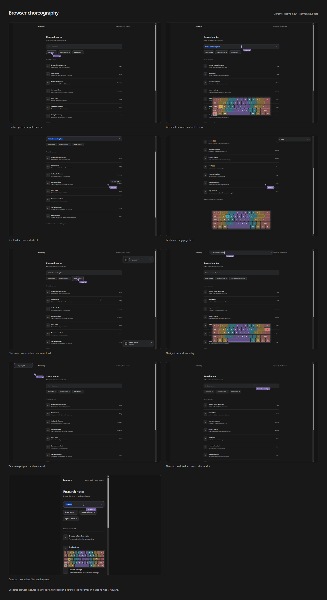

# Browser choreography

The presentation runs inside the active Chrome tab, so the live browser and
native recording show the same cursor, keyboard and action feedback. The design
follows the restrained palette, colored key groups and target corners of the
`browser-animations-demo` in Maximus Trading.

These are unaltered Chrome screenshots of the local walkthrough. Mouse and
keyboard input, scrolling, search, navigation, downloads, uploads and tab changes
use the browser APIs. The thinking example uses a scripted activity receipt;
the walkthrough makes no model requests.



[Play the native Chrome recording](media/choreography/demo.mp4).
The MP4 contains the presentation in the browser's captured pixels. Model-wait
intervals are cut by the recording plugin, including the scripted thinking phase.
Native browser toolbars are outside the recording; address and tab gestures use
temporary in-page indicators.

| Capture | Detail |
| --- | --- |
| [Pointer](media/choreography/pointer.png) | Named cursor, native hover and target corners. |
| [Keyboard](media/choreography/keyboard.png) | Complete German keyboard with native Ctrl+A. |
| [Scroll](media/choreography/scroll.png) | Direction and rotating wheel during native scrolling. |
| [Find](media/choreography/find.png) | Real page matches and the current result. |
| [Files](media/choreography/files.png) | Real download and native file upload. |
| [Navigation](media/choreography/navigation.png) | Address entry before navigation. |
| [Tabs](media/choreography/tabs.png) | Staged tab gesture before the native switch. |
| [Thinking](media/choreography/thinking.png) | Scripted model-activity receipt, shown live. |
| [Compact](media/choreography/compact.png) | Full keyboard at a 360-pixel viewport width. |
| [Observation](media/choreography/observation.png) | The same page captured without presentation pixels. |

## Reproduce

```console
uv run python -m examples.visualization --headed --layout de --theme dark
```

FFmpeg and a Chrome version supporting native Page recording must be available.
Omit `--headed` for a headless run. `--directory` changes the output directory;
`--layout en` and `--theme light` select the other appearance options.

The output includes individual PNGs, `overview.png`, `manifest.json`, the raw
recordings and timeline, and the edited `demo.mp4`. A local HTTP server serves
only the demonstration page, its download and the generated gallery.

## Configure

```python
from browserrig import IframeRenderer, InputVisualization

InputVisualization(renderer=IframeRenderer(
    name="Browserrig", keyboard_layout="de", theme="dark",
))
```

`InputVisualization(renderer=None)` keeps the transient events for an external
viewer. The general `tab.overlays` API owns the iframe's identity, lifetime and
visibility. Perception and recording do not import choreography. Read the
[surface API and capture behavior](browser-composition.md#browser-owned-presentation)
for clean screenshots, cancellation handling and custom surfaces.
