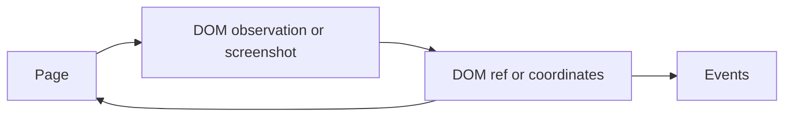

# Browser interaction

[Back to README](../README.md)



## Direct browser access

Use the browser without an LLM inside an async function:

```python
from browserrig import ChromeBrowser, wait_for_page
from browserrig.browser import Launch
from browserrig.scripts import PAGE_FACTS

async with ChromeBrowser(Launch(url="https://example.com")) as browser:
    tab = browser.active_tab
    await wait_for_page(tab)
    frame = await tab.main_frame()
    facts = await frame.run(PAGE_FACTS)
    print(facts.title)
```

Runnable examples:

```powershell
uv run python -m examples.direct_browser --url https://example.com
uv run python -m examples.connect_browser --endpoint http://127.0.0.1:9222
```

Connecting creates an isolated context in the running browser. Use
`--target-id TARGET` to explicitly select an existing tab. The external browser
must already expose a CDP endpoint and stays running after disconnecting.

Both `Launch` and `Connect` accept `session_setup=(setup, ...)`. Each setup
implements `SessionSetup` from `browserrig`: `async apply(cdp, *, frame) -> None`.
It runs once for each newly attached page (`frame=False`) or out-of-process frame
(`frame=True`) session, after page, lifecycle and runtime are enabled. The browser
applies the optional `viewport` metrics to pages first; custom setups then run in
the supplied order. `Viewport` only holds configuration data. Same-process frames
share their page's session.

## Element references and screenshot marks

`DomCapture` reads every frame document with one `DOMSnapshot.captureSnapshot` call per
CDP session and derives roles, names, states, visibility and landmark sections from
that data in Python, without walking the DOM in the page. Normal observations omit
page-text excerpts and do not capture new screenshots. Use `extract_content()`
to read the page. The agent can call `screenshot()` to request the current view as an
image in its next iteration. `ImageContext` keeps the latest screenshot by default,
including during subsequent text-only steps until compaction removes its snapshot.
`observe()` refreshes page state. Use
`BrowserPerception(screenshots=Screenshots(trigger=ScreenshotTrigger.EACH_STEP))` to enable images
on every step. Pass it in `plugins` of `Agent` or `browser_plugins()`; it replaces
the default `BrowserPerception()`.
`BrowserPerception(capture=DomCapture(max_text_chars=N))` enables a page-text excerpt; its
default is `0`. When the viewport holds fewer than five named controls, as on error, challenge
and confirmation pages, observations add up to `sparse_text_chars` (default `1500`)
characters of visible text anyway. Every observation states where the mouse rests.

An observation looks like this:

```text
# Checkout
url: https://shop.example/checkout
tab: 3F2A9C...
viewport: 1280x800, scroll 0 of 2400px (0.0 pages above, 2.0 below)
cursor: x=640 y=412 (viewport CSS pixels)
modal: dialog "Cookie settings" is open; interact with it first

in viewport:
  [HEADER]
    [12] link "Cart" -> /cart
  [MAIN]
    ## Shipping address
    <form "Shipping">
      [48] textbox "Email" required placeholder="you@example.com"
      [51] combobox "Country" options=[Germany*, France, Spain]
      *[57] checkbox "Save address" unchecked
    [60] button "Continue"
```

Only the elements and headings inside the viewport are listed and described; the
header's scroll position says how much of the page lies above and below, and the
agent scrolls to see more. A leading
`*` marks elements that were not in the previous observation of the same document. There is no default element-count limit;
`DomCapture(max_elements=N)` keeps the elements nearest to the viewport and reports
the truncation. Hidden, inert and fully clipped controls are omitted. Controls behind
a positioned overlay are reported as covered and are not listed individually.

DOM refs such as `482` or `f1:93` are CDP backend node ids, prefixed for out-of-process
frames. They stay valid across observations as long as the element stays in the same
document, and an action on a removed element fails with a stale-element error. Pass
the ref to `click`, `type_text` and other element tools.

Other capture backends can supply opaque refs through `CaptureContent.references`
and targets through `ElementInfo`, without DOM addresses. `click` and `drag` resolve
their current viewport positions and use the same mouse input and motor. A custom
target can be activated with pointer input and then receive `send_keys`. Native
form tools and `type_text(ref)` require a `DomElementHandle`; a mismatched ref is
rejected before input. See [reference contracts](browser-composition.md#references-from-other-capture-backends)
for resolver lifetime, live hit testing and optional wheel plans.

Requested DOM screenshots draw a labeled, colored dashed border around every element
in the viewport; each label is the element's ref. Links use blue borders, buttons
green, text inputs purple, and selection controls pink or orange. Screenshots use
viewport CSS pixels even on HiDPI displays. Annotations are drawn on the image
without changing the page. Use `BrowserPerception(capture=DomCapture(marks=False))` for plain screenshots.

Extraction follows the composed DOM, including slots, open and closed shadow roots,
and CDP click-listener metadata. It checks viewport visibility, clipping and
overlays without scrolling during observation. Nested same-origin and cross-origin
frames use their own CDP sessions where needed. Frame transforms account for
borders, scrolling, scaling and rotation; ancestor hit tests reject covered frames
before clicking. Unreachable frames and content limits are reported as `note:`
lines, while usable frames remain available. Frame discovery is bounded to 64
frames and eight levels; perspective transforms are reported as unsupported.

## JavaScript shell and forward navigation

`execute_javascript(code="1 + 1")` runs JavaScript through CDP's `Runtime.evaluate`
in the active tab's main page context.
The tool returns the last expression's value, supports top-level `await`, and keeps
variables between calls until the page navigates. Use `await` for Promise results.
Return plain objects and arrays
for JSON results; `undefined`, `NaN`, infinities, and BigInts retain their JavaScript
representation. JavaScript exceptions and execution timeouts become tool errors.
`timeout` is in seconds, defaults to 10, and accepts up to 30. A timeout can leave
asynchronous side effects pending; check the next observation before retrying.

```javascript
const heading = document.querySelector('h1');
({ title: document.title, heading: heading?.textContent });
```

`go_forward()` navigates to the next browser history entry, complementing
`go_back()`. Its tool result confirms `Navigated forward.` or reports
`Cannot go forward: no next history entry` when no forward navigation is possible.

Direct Python callers can use `await tab.evaluate("1 + 1")` for a rendered result,
`await tab.can_go_forward()` to check availability, and `await tab.go_forward()`
for a boolean indicating whether a history navigation was dispatched. Agent tools
use the shared action lock, readiness checks, and action receipts.

## Page content as Markdown

The agent can call `extract_content(max_chars=50000)` to read the active page as
structured Markdown. The result includes the page title and source URL, headings,
paragraphs, emphasis, lists, links with absolute URLs, tables, quotes, and code.
It reads already loaded content below the viewport without scrolling, navigating,
or invalidating the current element references. Open and closed shadow roots and
available same-origin and cross-origin frame documents are included.

`max_chars` limits the Markdown body (1–200000 characters); the title, source URL,
and extraction limitations are reported separately. Truncation, unavailable DOM
metadata, and unavailable frames are explicit. Offscreen rendered frame documents
are included. Scripts, styles, hidden content, and form field values are excluded.
Lazy content must already be
loaded; images contribute their alt text, and canvas pixels are not converted to
text. Use `screenshot()` when visual inspection is needed.

## Finding text on the page

`find_in_page(query, alternatives=(), match=1, max_results=10)` works like the
browser's find bar. It searches the rendered text of every frame, ignores case,
accents and whitespace differences, and keeps each match within one text block.
Up to four `alternatives` (synonyms, other spellings or languages) are searched in
the same call; their matches share one numbering in page order, and where two
overlap the earlier, then longer, one counts. The reply gives the number of matches
per wording and lists up to `max_results` matches from `match` onward with their
surrounding text and nearest heading.

Match number `match` is scrolled into view; a closed `<details>` or a
`hidden="until-found"` section around it is opened first. Nothing is drawn on the
page: viewers get the matches' viewport rectangles in `FindResultsEvent` and draw
the find highlights themselves. Hidden text and form field values are not searched.

## Double-clicks and dragging

DOM interactions prepare the target's viewport automatically with native, eased
wheel input, including horizontal scrolling, nested scroll containers, and parent
frames. Comfortable targets stay in place. Near-edge and offscreen targets are
positioned with a 12% comfort margin and a preferred vertical anchor around one
third of the viewport; fitting form groups and labels are kept together. Fixed
and pinned sticky controls do not trigger document scrolling. Coordinates and
ancestor hit tests are refreshed after scrolling and before dispatching input.
Typing, selecting options, setting date inputs, and uploads use this preparation
as well as clicks. Focus uses `preventScroll` to avoid an extra browser jump.

`PointerTools` provides `click(ref=..., count=2)` and
`drag(source_ref=..., target_ref=...)` when the capture has DOM refs. Both drag endpoints are prepared first and
must fit in the viewport together before the gesture starts.

It always provides `move_mouse(x=..., y=...)`,
`scroll(delta_y=...)`,
`click_at(x=..., y=..., count=2)` and
`drag_at(start=Point(...), end=Point(...))`.
Both drag tools use the same mouse gesture. The browser handles pointer dragging
and native HTML5 drag and drop, including `DataTransfer`, automatically.
`move_mouse` moves the cursor without clicking and can reveal hover controls.
`scroll` sends wheel input at the current cursor position: move over a sidebar,
panel, or other scrollable area first to scroll that area.
Both `click` and `click_at` accept `button="right"` for a native right click;
the default is `button="left"`. Both tools automatically move the cursor to the
target before clicking. Right clicks end the action chain so the agent can
inspect the result before continuing.
`wait(seconds=...)` pauses for 0–10 seconds (default: 1) and emits a transient
`WaitingEvent` (`browser.waiting`) before the pause, with its requested duration,
browser, tab, and document IDs for live UI display.
The newest image shown to the model determines how crop coordinates map to the viewport;
subsequent text-only observations retain that image's geometry.
Model screenshots omit application overlays and the presentation cursor.
Set `DomCapture(cursor=True)` to add a red cursor arrow after capture, with its tip
at the exact input coordinate. This optional marker follows crop and zoom coordinates.
All gestures use real CDP input and release mouse buttons even when interrupted.
Workspace tools are hidden without the `Files` plugin, and previews and uploads
are hidden when the browser has no file bridge; `list_downloads` remains
available. See [Files and events](files-and-events.md#workspaces-bridges-and-remote-browsers).

## Input choreography

The browser has one mouse and one keyboard, `browser.mouse` and
`browser.keyboard`, also available as `browser.input.mouse` and
`browser.input.keyboard`. Both act on the active tab. `browser.input` shares the
action context and event correlation across both devices. Browser tools
use these same devices; `Actions` owns action serialization and readiness.
Tab management lives in `browser.tabs`: `list()`, `open(target)`,
`activate(target_id)` and `close(target_id)`. `browser.tabs.active` and
`browser.active_tab` return the focused document.

JavaScript, navigation, frames, dialogs and element references stay on `Tab`.
Its `input` adapter implements the `InputTarget` transport protocol and owns CDP
dispatch, cursor probes and dialog-aware replies. Mouse and keyboard gestures
resolve this adapter once when they start, so a click or drag stays on the same
session; without an active tab, input raises `BrowserError`.

How input is performed and how it looks to people watching are two separate,
optional plugins. Tools and devices only describe what they do. `InputPacing` (from
`browserrig.pacing`) types and moves the pointer like a person; `InputVisualization` (from
`browserrig.choreography`) plays the gestures below and streams them as live events.
`browser_plugins` and `Agent` include both by default; pass `without=(InputPacing,)` to work
at full speed, `without=(InputVisualization,)` to emit no input events, or both. They build
on four seams, which other plugins can use the same way:

- `browser.input.pace(motor)` installs a `Motor` that plans keystrokes, pointer
  routes, where to aim on a target, how long a click holds the button, and landing
  points. `InputPacing(motor)` installs one for a session; its
  default is `HumanMotor()`. Both built-in motors land in the center of a new
  tab. The default without a plugin, `Instant`, never pauses.
- `browser.input.present(presenter)` installs a `Presenter` that plays tab-strip
  gestures and reports each input event. The default, `Unseen`, reports nothing.
  Both calls return a callback that restores the previous motor or presenter.
- `Actions.stage(intent, tab, step)` dispatches a `Perform` waterfall around a tool
  step. A hook that matches the intent (`FindIntent`, `NavigateIntent`, `WaitIntent`,
  `OpenFileIntent`, `UploadIntent`) stages the step and calls `next_()` to run it.
- `TargetLocated` is observed once a tool has resolved its target element.

The mouse remembers where it last rested in each tab (`browser.mouse.position_in(tab.id)`)
and returns there when that tab comes back to the front. The first time a tab
receives the pointer, both built-in motors put it in the center of the actual
viewport. A custom motor can choose another landing point. There is no animation
from the top-left corner. With `InputVisualization`, opening, activating
and closing tabs play a tab-strip gesture:

1. `TabPressedEvent` (`browser.tab.pressed`) belongs to the tab the pointer
   leaves. It carries `gesture` (`TabGesture.OPEN`, `ACTIVATE` or `CLOSE`), the
   pressed `tab_id` (empty for the new-tab button), `from_position` and
   `duration`. The harness waits `duration`, then switches tabs.
2. `CursorEnteredEvent` (`browser.cursor.entered`) belongs to the new tab. The
   pointer travels from the tab strip to `to_position`; the harness waits again.
3. A native mouse move lands at that position, so hover in the new page is real,
   followed by `browser.cursor.state`.

The backend does not know the viewer's layout. A viewer places the tab chip
itself, for example through a `data-target-id` attribute, and draws the gesture
in an overlay spanning its tab strip and the viewport. The first tab of a
session skips steps 1 and 2. `InputVisualization` publishes the current cursor state at
each agent turn start, so live subscribers attached after browser setup can display
it before the first model request or input action.
Cursor movements follow `Motor.pointer_route(start, destination)`: one or more cubic strokes
(`CursorPath`), each joined to the last and reported as its own
`browser.cursor.moved`. A route that does not run unbroken from the pointer to its
destination is refused before the pointer moves. The built-in motors move in one
bounded stroke (`CursorPath.curved`), aim at the middle of a target and click
without holding the button. A custom motor's aim is a pair of fractions of the
target's visible box; if something covers that spot, the hit test falls back to the
target's other visible points. Within one action, a target keeps its aim, so the
re-check after hover lands on the same spot. Scrolling looks like Chrome's
`scroll-behavior: smooth` but uses real wheel input: one trusted CDP wheel event
per frame along Chrome's smooth scroll curve (`cubic-bezier(0.4, 0, 0, 1)`),
lasting about one 60 Hz frame per square root of the distance (150 ms to 1.5 s).
Chrome does not animate CDP wheel events itself, and `Input.synthesizeScrollGesture`
moves at constant speed, so the harness paces the wheel events.
With `InputPacing`, typing uses a fixed 50 ms interval
(`browserrig.input.TYPING_INTERVAL_SECONDS`) and pointer paths take their
time; without it, keys and moves are dispatched without pauses.

`KeyboardTools` supplies `send_keys`. It addresses the current page
focus and takes exactly one of `text` or `key`:

- `send_keys(text="Hello world")` types literal text at the current selection.
- `send_keys(text="Enter")` types the word Enter.
- `send_keys(key="Enter")` presses Enter.
- `send_keys(key="Escape")` presses Escape.
- `send_keys(key="a", hold_control=True)` selects all text in the focused editor.
- `send_keys(key="Tab", hold_shift=True)` moves focus backwards.

`hold_control`, `hold_shift`, `hold_alt`, and `hold_meta` apply to `key`. All held
modifiers are released after the key. Literal text uses `text` without modifier flags.

With DOM refs, `KeyboardTools` also supplies `type_text(ref=..., text=...)` to focus and
replace a referenced field. Use `clear=False` to type at its current selection.

Keys and modifiers are released on failure or cancellation. The motor plans the
keys for text as `KeyStroke(key, delay_after)`: characters, and `Backspace` to erase
one it typed. The built-in motors dispatch each character once, without slips. A
custom motor may slip and correct itself; the plan is checked before the first key,
and `type_text` returns `TypedText(intended, entered)`. When a slip stays, the tools
say so (without echoing text around a secret). Sensitive text refuses any plan
that does not type it exactly. Empty replacement text
clears the field. Direct Python callers can use `browser.keyboard.type_text(...)`,
`browser.keyboard.press_key(...)`, `browser.mouse.move_to(Point(...))`, and
`browser.mouse.scroll(delta_y=..., point=Point(...))`. Acquire `browser.action_lock`
when combining direct inputs with other browser actions.

The choreography uses Harnessed's native transient event extension. `InputVisualization`
registers the input events (`browserrig.events.INPUT_EVENTS`) and its scene events
(`browserrig.choreography.SCENE_EVENTS`); `TabStrip` registers the tab updates
(`browserrig.events.TAB_STRIP_EVENTS`), and `Chrome` registers download progress
alongside its durable browser events:

| Event | Payload |
| --- | --- |
| `CursorMovedEvent` | Start, destination, two control points, duration, easing |
| `CursorStateEvent` | Actual cursor position and held mouse buttons |
| `TabPressedEvent` | Tab-strip gesture, pressed tab ID, start position, duration |
| `CursorEnteredEvent` | Landing position in the new tab, duration, easing |
| `CursorStyleEvent` | CSS cursor under the pointer (`CursorStyle`, such as `pointer` or `text`) |
| `PointerPressedEvent`, `PointerReleasedEvent` | Position, mouse button and native click count |
| `KeyPressedEvent` | Key, modifiers, duration |
| `KeyboardVisibilityEvent` | Keyboard presentation opened or closed |
| `BarTypedEvent` | Browser bar (`address` or `find`), key, bar text after the key, duration |
| `FindBarEvent` | Find bar opened or closed |
| `FindResultsEvent` | Find bar text, match count, current match (0 for none), viewport rects of visible matches |
| `ScrollStartedEvent` | Wheel origin, planned deltas and duration, emitted before native wheel dispatch |
| `ScrolledEvent` | Wheel origin, dispatched deltas, duration |
| `HighlightElementEvent` | DOM reference and viewport bounds |
| `WaitingEvent` | Requested wait duration |
| `FileTransferEvent` | `open` or `upload`, file paths, duration and the upload target point |
| `WorkPresentedEvent` | Shared browser/Canvas work receipt: identity, typed phase, preview, result metadata, saved path and source capture geometry |
| `DownloadProgressedEvent` | Download ID, received bytes and total bytes when known |
| `TabUpdatedEvent` | URL, document title, `loading` flag and favicon as a `data:` URI |

Coordinates use viewport CSS pixels; durations use seconds. Events carry
`browser_id`, `target_id`, `document_id`, and `at`. Inputs inside an action also
carry its `action_id`. `CursorMovedEvent` describes the path before execution;
`CursorStateEvent` reports the actual endpoint, including after cancellation.
Key and pointer receipts follow successful dispatch. Action failure events close
interrupted sequences. Key events contain the dispatched key and modifiers.
`ScrollStartedEvent` starts wheel feedback during native scrolling;
`ScrolledEvent` reports the dispatched totals after it finishes or is interrupted.

`InputVisualization` paces what it shows: events with a `duration` describe an
animation the browser waits through before continuing. `open_file` and
`open_downloaded_file` emit a `FileTransferEvent` in the current tab, wait for it,
and only then open the new tab, which plays the tab-strip gesture. Uploads move the cursor onto the file input, emit
the transfer with that point, wait, and then assign the files.
`CursorStyleEvent` follows cursor movement and scrolling and is only emitted when
the style changes. It reads the page's computed CSS cursor and treats text inputs,
editable content and plain text as `text`; custom cursor images show `default`.
The probe is best-effort and never delays input by more than 250 ms; it runs
only while a presenter such as `InputVisualization`'s `Stage` asks for it, so unwatched
input never probes.
`DownloadProgressedEvent` is sent at most every 200 ms per download; completion,
failure and cancellation remain durable events.

`TabUpdatedEvent` lets a viewer draw its own tab strip. The `TabStrip` plugin
(`browserrig.choreography`, on by default, `without=(TabStrip,)` to opt out) sends it
whenever a field changes: `loading` follows the main frame, and the title and icon
are read from the page once it stops loading. A newer title from Chrome replaces
the one the document declared. The tab itself only reports that it changed,
through the `TabChanged` hook event from `browserrig.browser`; without `TabStrip`
no titles or icons are read. Icons are fetched through the browser without cookies,
capped at 64 KiB, typed from their bytes and dropped otherwise. SVG icons are safe
only when rendered through ``. A loading tab keeps its previous icon.

`navigate(url, new_tab=True)` opens the URL in a new tab; `open_tab` without a URL
starts on DuckDuckGo. The durable `NavigationStartedEvent` carries `typed`, the text
a person would enter in the address bar: the URL without `https://` (and without a
bare trailing `/`), or the query for `search`. With `InputVisualization`, `BarTypedEvent`s show
the text being typed into the address bar key by key, ending with `Enter`; nothing
is typed into the page.

With `InputVisualization`, `find_in_page` plays a person's Ctrl+F: a `KeyPressedEvent` for `f` with
`Control`, `FindBarEvent(visible=True)`, one `BarTypedEvent` per key with a
`FindResultsEvent` after each, then the final results with the current match in
view, and finally `Escape` and `FindBarEvent(visible=False)`. `FindResultsEvent.marks`
holds the visible matches numbered from 1 in page order, and `active` names the
current one, so viewers can draw the familiar yellow and orange highlights over the
screencast.

Navigation, tab changes, downloads, and model/tool/readiness/pause intervals keep
their existing typed events. Consumers can use those together with input events
to present the session's choreography. Transient input events reach subscribers only; they
stay out of `session.events`, run results, saved `SessionState` and model context.

`TerminalEvents()` prints one JSON object per event to stderr using native hooks,
without a background consumer task. It includes session lifecycle, model/tool
metadata, browser actions, live input events, correlated compaction attempts and
typed model retry activity. Tool records include `tool_status` and `break_chain`.
Retry records retain `request_id`, `retry_group_id` and `retry_kind`; unknown
attempt/retry counters remain JSON `null`. Provider attempts, context recovery and
output correction have separate scopes. Prompts, tool arguments, model
output, and screenshots are omitted. Pass `TerminalEvents(output=file)` to select
another text stream.
Page text, dialog messages and form value fields are omitted; URLs, filenames and
dispatched key names remain diagnostic metadata.
